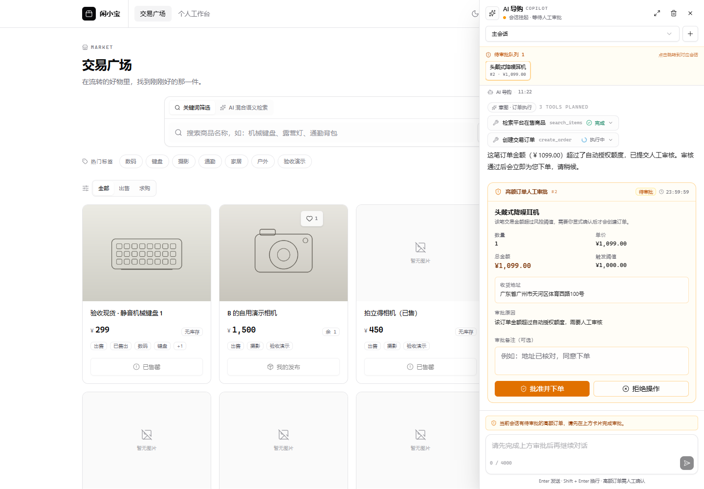
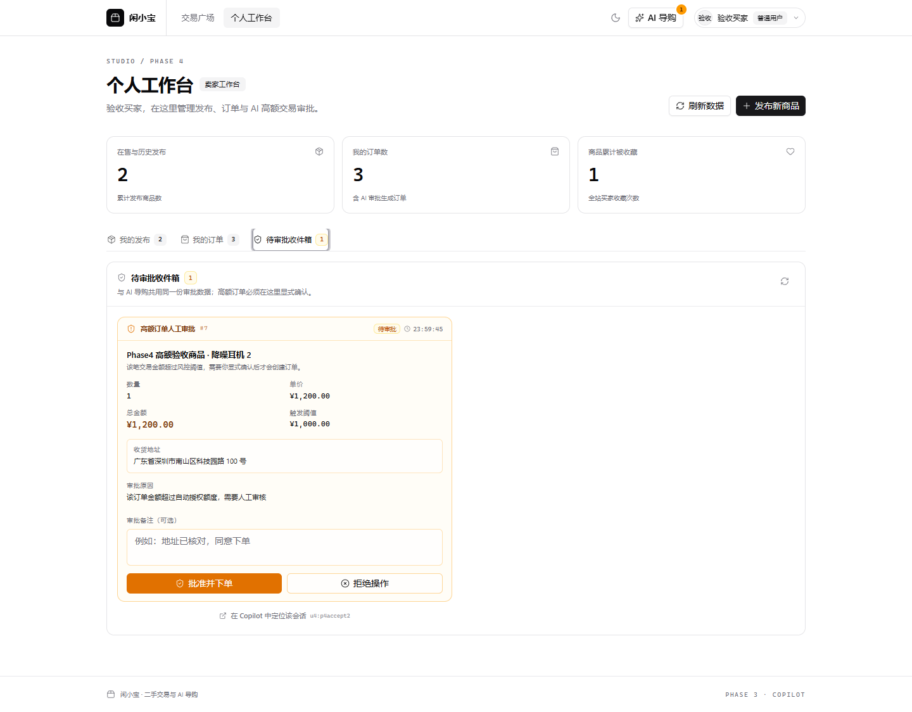

<div align="center">

# 闲小宝 · 智能二手交易平台（前端）

**一个带 AI 导购与人工审批闭环的二手交易前端。**

React 19 · TypeScript · Vite 8 · Tailwind CSS v4 · Zustand

[](https://react.dev/)
[](https://www.typescriptlang.org/)
[](https://vite.dev/)
[](https://tailwindcss.com/)
[](https://playwright.dev/)
[](LICENSE)

[功能](#功能) · [截图](#界面预览) · [快速开始](#快速开始) · [工程说明](#工程说明) · [测试](#测试) · [文档](#文档与验收记录)

</div>

---

## 关于这个项目

「闲小宝」是一个个人实践项目：把二手交易里常见的**发布 / 检索 / 收藏 / 下单**流程，和
**AI 导购 + 高风险订单人工审批**串成一个完整闭环。本仓库是它的前端，配套后端仓库为
[**N1rvana-git/fastapi**](https://github.com/N1rvana-git/fastapi)。

我尽量用接近生产环境的方式要求它——严格的 TypeScript、统一的错误契约、Token 静默续期、
SSE 断线续播、幂等键与 Playwright 韧性用例——但它本质上仍是学习过程中的作品，
**尚未在真实生产环境长期运行**，也存在下面[已知限制](#已知限制)中列出的不足。
把它开源出来，主要是记录过程、接受指正，也希望能给同样在学 React + FastAPI 的朋友一点参考。

> 界面文案为简体中文；代码注释以中文为主。

---

## 功能

### 交易广场 `/market`

- 关键词搜索与 **AI 混合语义检索**（自然语言描述也能找到商品）
- 出售 / 求购分类、热门标签筛选、分页
- 商品详情、收藏、抢购确认弹窗、售罄与下架状态
- 未登录可浏览，抢购与收藏会引导登录

### AI 导购 Copilot

- 右侧抽屉式对话，基于 `fetch` + `ReadableStream` 的 **SSE 流式输出**
- 工具调用过程可视化（如 `search_items`、`create_order`），逐步展示计划与结果
- **高额订单中断 - 人工审批 - 恢复执行**：后端返回高风险时，前端锁定输入框，
  必须先在审批卡上「批准并下单」或「拒绝操作」
- 线程隔离与历史持久化；审批数据与工作台共用同一份，切换页面不丢状态
- 流中断后携带 `Last-Event-ID` 自动续播，正文不丢字、不重复

### 个人工作台 `/studio`

- 我的发布：发布 / 编辑商品、图片上传、AI 识图辅助填写
- 我的订单、收藏列表与统计卡片
- **待审批收件箱**：与 Copilot 共用审批记录，可直接定位回对应会话
- 审批失败（如库存不足）后可将终态订单「重新提交」

### 管理控制台 `/admin`（仅管理员）

- 系统运行时探针：database / redis / llm 健康状态
- 用户与 RBAC 角色管理（含自我降级的二次确认）
- 平台标签治理：新建、删除标签

### 工程韧性

- Access Token 到期前**静默续期**，并发请求共享同一个 Single-Flight 续期 Promise
- 全局 401 统一清理本地会话；主动退出登录会调用后端 `POST /auth/logout` 吊销历史 Token
- 写接口自动补 `X-Idempotency-Key`，重复点击不会重复下单
- 统一错误信封解析（`code` / `message` / `trace_id` / `details` / `retry-after`），
  错误提示可一键复制 Trace ID
- 路由级与消息级 `ErrorBoundary`，单点渲染异常不会白屏

---

## 界面预览

| 交易广场 | AI 导购与人工审批 |
| :---: | :---: |
|  |  |
| 关键词 / AI 语义检索、标签筛选、抢购入口 | 工具调用时间线、流式回复、审批中断 |

| 工作台 · 待审批收件箱 |
| :---: |
|  |

更多阶段验收截图见 [`docs/assets`](docs/assets)。

---

## 技术栈

| 分类 | 选型 | 说明 |
| --- | --- | --- |
| 框架 | React 19 + TypeScript（strict） | 函数组件 + Hooks，路径别名 `@/` |
| 构建 | Vite 8 | 按依赖手动分包（react / radix / markdown / lucide） |
| 样式 | Tailwind CSS v4 + shadcn/ui（New York / Neutral） | 设计令牌集中在 `src/index.css` |
| 状态 | Zustand 5 | `auth` / `agent` / `theme` 三个 Store |
| 路由 | React Router 7 | 路由守卫 + 懒加载页面 |
| 请求 | Axios + 原生 `fetch` | REST 走 Axios；SSE 走 `fetch` + `ReadableStream` |
| UI 细节 | Radix UI、Lucide、Sonner、react-markdown | 无 Emoji 图标，统一线性图标 |
| 测试 | Playwright（系统 Chrome） | 韧性、断流续播与混沌用例 |

---

## 快速开始

### 环境要求

- Node.js **≥ 20.19**（建议 22 LTS 或更新；Vite 8 的要求）
- 可访问的「闲小宝」后端（默认 `http://localhost:8000`）

### 1. 启动后端

请按后端仓库 [N1rvana-git/fastapi](https://github.com/N1rvana-git/fastapi) 的 README 启动服务，
确认 `http://localhost:8000/health` 或接口文档可访问。

### 2. 启动前端

```bash
git clone https://github.com/N1rvana-git/secondhand-ai-marketplace.git
cd secondhand-ai-marketplace

npm install

# 配置后端地址（Windows: copy .env.example .env）
cp .env.example .env

npm run dev
```

打开 <http://localhost:5173>。

`.env` 只需一个变量：

```env
VITE_API_BASE_URL=http://localhost:8000
```

> 开发服务器同时把 `/uploads`、`/static` 代理到 `http://localhost:8000`，
> 便于直接加载后端托管的图片。

### 3. 可用脚本

| 命令 | 作用 |
| --- | --- |
| `npm run dev` | 启动开发服务器（`127.0.0.1:5173`，端口固定） |
| `npm run build` | 类型检查 + 生产构建到 `dist/` |
| `npm run preview` | 本地预览构建产物 |
| `npm run typecheck` | `tsc --noEmit` |
| `npm run lint` | `oxlint` 静态检查 |
| `npm run test:e2e` | 运行全部 Playwright 用例 |

---

## 工程说明

### 目录结构

```text
.
├─ src/
│  ├─ api/          # Axios 实例、拦截器、token 续期、各业务接口封装
│  ├─ stores/       # Zustand：auth / agent / theme
│  ├─ features/     # market / agent / studio / admin 业务组件
│  ├─ pages/        # 路由页面
│  ├─ components/   # 应用外壳、shadcn/ui 基础组件、ErrorBoundary
│  ├─ layouts/      # AppShell / AuthLayout
│  ├─ router/       # 路由表与访问守卫
│  ├─ lib/          # token 存取、格式化、错误提示
│  ├─ types/        # 与后端对齐的 API 类型契约
│  └─ hooks/
├─ e2e/
│  ├─ support/      # 登录态注入、接口 Mock 工具
│  ├─ resilience.spec.ts
│  ├─ sse-reconnect.spec.ts
│  └─ hell-chaos.spec.ts
├─ docs/            # 阶段验收报告与截图
├─ public/
├─ playwright.config.ts
└─ vite.config.ts
```

### 几个设计取舍

- **契约先行**：接口类型集中在 `src/types/api.ts`，错误统一为 `{ error: { code, message, trace_id, details } }`，
  页面只消费归一化后的 `ApiError`。
- **认证**：本地同时保存 `access_token` 与 `access_token_expires_at`；距过期不足 10 分钟时
  **Single-Flight** 续期，避免并发雪崩。401 只做本地清理，主动登出才请求后端吊销。
- **SSE 与幂等**：SSE 请求携带幂等键，断流重连复用同一个键并带 `Last-Event-ID`，
  服务端可据此续写；前端按游标去重，保证正文不重复。
- **审批状态机**：以 `interrupted / pending / executing / approved / rejected / failed / expired`
  驱动卡片与输入框状态，审批完成前禁止继续对话，避免模型绕过人工确认。
- **渲染安全**：Markdown 渲染禁用原始 HTML，并对畸形 Markdown / XSS 注入有专门用例。

---

## 测试

Playwright 用例全部使用确定性 Mock，不依赖外网 LLM 与真实后端，可重复运行：

```bash
npx playwright test          # 或 npm run test:e2e
```

| 套件 | 用例数 | 覆盖内容 |
| --- | ---: | --- |
| `e2e/hell-chaos.spec.ts` | 6 | 连续断流续传、XSS / 畸形 Markdown、连点幂等、并发撞临期 Token、审批失败重提 |
| `e2e/resilience.spec.ts` | 3 | Single-Flight 续期、审批失败降级、主动登出吊销与 500 容错 |
| `e2e/sse-reconnect.spec.ts` | 1 | `Last-Event-ID` 续播、幂等键复用、前半句零重复 |
| **合计** | **10** | 当前全部通过 |

说明：

- 默认复用系统 Chrome（`channel: 'chrome'`）。若想使用 Playwright 自带 Chromium：
  ```bash
  npx playwright install chromium
  PLAYWRIGHT_CHANNEL=chromium npx playwright test   # Windows PowerShell: $env:PLAYWRIGHT_CHANNEL='chromium'
  ```
- E2E 使用 `--mode test` 加载 `.env.test`，把 API 指到同源 `127.0.0.1:4173` 以便 `page.route` 拦截。

---

## 文档与验收记录

开发过程中按阶段留下了实现与验收报告，包含设计说明、关键代码和验收截图：

| 文档 | 内容 |
| --- | --- |
| [PHASE2 验收报告](docs/PHASE2-ACCEPTANCE-REPORT.md) | 交易广场、检索、收藏与抢购 |
| [PHASE3 验收报告](docs/PHASE3-ACCEPTANCE-REPORT.md) | AI Copilot、SSE 流式与审批闭环 |
| [PHASE4 验收报告](docs/PHASE4-ACCEPTANCE-REPORT.md) | 工作台表单、订单与审批收件箱、管理台 |
| [H2 韧性加固](docs/SPRINT-H2-RESILIENCE-REPORT.md) | Token 续期、ErrorBoundary、错误提示 |
| [H2 验收](docs/SPRINT-H2-ACCEPTANCE-REPORT.md) | 韧性加固的验收记录 |
| [H3-FE 验收](docs/SPRINT-H3-FE-ACCEPTANCE-REPORT.md) | 审批终态重提、幂等审计与混沌测试 |
| [登出吊销接入](docs/FE-LOGOUT-TOKEN-REVOKE-REPORT.md) | `POST /auth/logout` 接入与 E2E 校验 |
| [集成报告](docs/INTEGRATION-REPORT.md) | 前后端联调记录 |

---

## 已知限制

- 必须配合后端才能完整运行；前端没有内置离线 Mock 服务器。
- E2E 默认依赖本机已安装的 Chrome，CI 上需安装 Chromium 或改用容器。
- 尚未配置 GitHub Actions / CI，`oxlint` 仍有少量 warning（0 error）。
- 仅提供简体中文界面，未做 i18n；移动端适配仍在打磨。
- 支付、物流、风控等真实交易能力未接入，AI 导购依赖后端模型与工具链。
- 这是学习型项目，**不建议直接用于生产**。

## Roadmap

- [ ] 接入 GitHub Actions：typecheck / build / Playwright
- [ ] 清理 lint warning，补齐组件级测试
- [ ] 视觉回归截图对比
- [ ] 响应式与无障碍细节完善

---

## 贡献

这是一个个人项目，非常欢迎 Issue 与 Pull Request，尤其是 bug 报告和可访问性建议。
不过维护精力有限，回复可能不够及时，请见谅。

提交前建议至少跑通：

```bash
npm run typecheck
npm run build
npm run test:e2e
```

---

## License

本项目使用 [MIT License](LICENSE) 开源。

## 致谢

- [React](https://react.dev/)、[Vite](https://vite.dev/)、[Tailwind CSS](https://tailwindcss.com/)
- [shadcn/ui](https://ui.shadcn.com/) 与 [Radix UI](https://www.radix-ui.com/)
- [Zustand](https://zustand.docs.pmnd.rs/)、[React Router](https://reactrouter.com/)
- [Playwright](https://playwright.dev/) 与 [Sonner](https://sonner.emilkowalski.com/)
- 后端与 AI 能力来自 [N1rvana-git/fastapi](https://github.com/N1rvana-git/fastapi)

如果这个项目对你有帮助，欢迎点个 Star；也欢迎指出问题，我会尽量修正。
