# Phase 2 交易广场 · 人工验收报告

> **结论：已完成，5/5 通过。**
>
> 你提到“4 个必测场景”，但清单实际列出了 5 项；本报告按 **5 项** 逐条记录，全部通过。验收过程中另发现并修复了 1 个图片缓存回显缺陷。

| 项目 | 信息 |
| --- | --- |
| 验收时间 | 2026-11-20 23:23:42 — 23:24:16（Asia/Shanghai） |
| 前端地址 | `http://127.0.0.1:5173/market`（Vite dev server，当前仍在运行） |
| 后端地址 | `http://localhost:8000`（FastAPI，已加载最新契约） |
| 浏览器 | Chrome headless，1440 × 1000，`zh-CN` |
| 执行方式 | Playwright 驱动真实 Chrome 会话，真实后端 / 真实账号，非 mock |
| 视觉模型 | `VISION_ENABLED=false`（503 降级为预期路径） |
| 页面异常 | 0 个 `pageerror` |
| Console 错误 | 1 条，为预期内的 503 资源加载日志 |
| 总结论 | **PASS 5/5** |

> **截图说明**：除 12/13 抢购弹窗外，其余界面截图在验收完成后补拍；补拍时 item 17 已被买走，因此部分列表 / 标签截图中该商品显示「无库存 / 已售罄」。接口数据与断言以验收执行记录为准。
>
> 接口契约修复、后端测试与改动明细见 [INTEGRATION-REPORT.md](./INTEGRATION-REPORT.md)。

## 0. 验收账号与数据

为完成真实登录、收藏、抢购，已在本地后端创建两组验收账号和一批商品，未修改后端代码。所有商品均带 `验收演示` 标签，可在交易广场按该标签筛选查看。

| 角色 | 用户名 | 邮箱 | 密码 | user_id |
| --- | --- | --- | --- | --- |
| 卖家 A | 验收卖家 | `p2accept.mwp4lzxg.seller@example.com` | `Acceptance#2026` | 3 |
| 买家 B | 验收买家 | `p2accept.mwp4lzxg.buyer@example.com` | `Acceptance#2026` | 4 |

关键商品：

| 商品 | item_id | 归属 | 用途 |
| --- | --- | --- | --- |
| B 的自用演示相机 | 16 | 买家 B | 收藏用例；A 收藏后 B 看到 `favorited=false` / `count=1` |
| 验收现货 · 静音机械键盘 1 | 17 | 卖家 A | 幂等抢购用例；单价 ¥299，初始库存 1，现已售罄 |

> 如需复跑抢购用例，需要先用卖家 A 新建一件 `inventory=1` 的他人商品；item 17 已归零，无法重复抢购。账号与演示数据保留，便于人工复核。

---

## 1. 门禁总览

| # | 必测场景 | 结果 | 关键判定 |
| --- | --- | --- | --- |
| 1 | 三态浏览：全部 / 出售 / 求购 + 翻页 | ✅ PASS | 每次操作命中 `GET /items`，`is_offer_filter` / `skip` 参数正确；另验证 `tag_id` 精确过滤 |
| 2 | AI 混合语义检索 + lexical 回退 | ✅ PASS | 命中 `POST /items/search-by-text`，请求含 `include_wants:true`，返回 `mode=lexical`、`match_reason=lexical`、数字 `score`，卡片正确展示 |
| 3 | 以图搜图 503 降级 | ✅ PASS | 真实后端返回 `503 FEATURE_UNAVAILABLE`，页面展示降级引导条，无红屏 / 无未捕获异常 |
| 4 | 收藏与详情实时性 | ✅ PASS | `POST /items/16/favorite` 成功，卡片心形与数量即时变化；详情、刷新后均回显 `favorited=true` / `1` |
| 5 | 防超卖幂等抢购 | ✅ PASS | 请求头携带 `X-Idempotency-Key`；订单成功后库存 1 → 0，卡片变为「已售罄」；自己的发布按钮禁用 |

---

## 2. 逐项验收证据

### 2.1 三态浏览与分页

**操作与 Network 结果：**

| 操作 | 实际请求 | 状态 | 响应摘要 |
| --- | --- | --- | --- |
| 打开交易广场 | `GET /items?skip=0&limit=12` | 200 | `total=17`，返回 12 条 |
| 切换「出售」 | `GET /items?skip=0&limit=12&is_offer_filter=true` | 200 | `total=14`，所有条目 `is_offer !== false` |
| 切换「求购」 | `GET /items?skip=0&limit=12&is_offer_filter=false` | 200 | `total=3`，所有条目 `is_offer=false` |
| 翻到第 2 页 | `GET /items?skip=12&limit=12` | 200 | `skip=12`，返回 5 条，分页显示「第 2 / 2 页」 |
| 点击「数码」标签 | `GET /items?skip=0&limit=12&tag_id=1` | 200 | `total=5`，命中名称不含「数码」的「复古胶片相机（含原厂背带）」 |

**判定：** 筛选、分页均走服务端 `GET /items`，参数未臆造；标签改为 `tag_id` 后，确实按关联关系命中，而不是名称关键词。

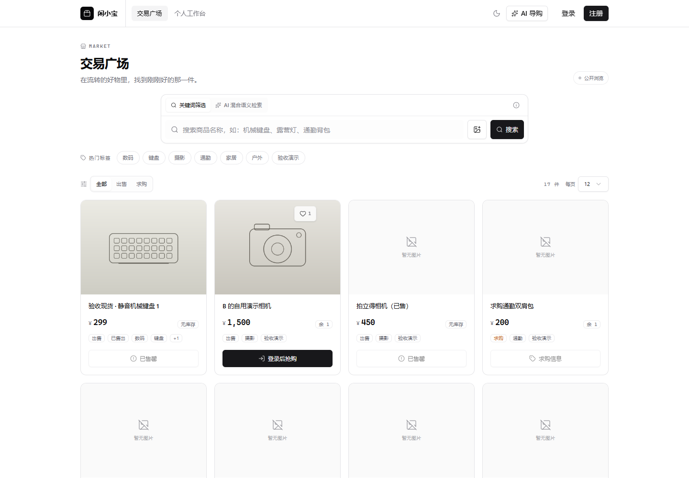

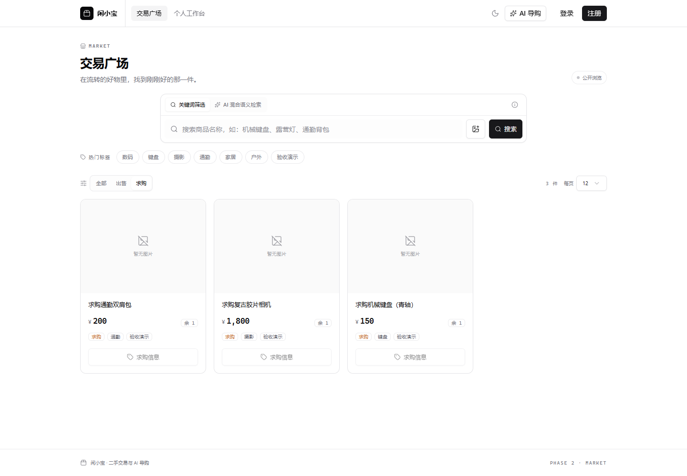

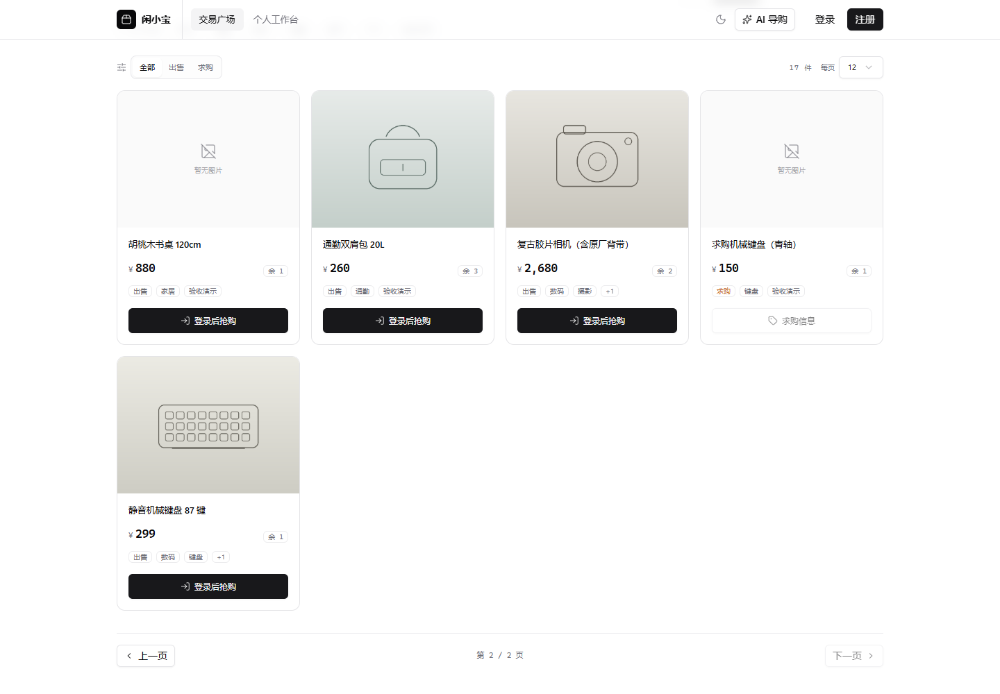

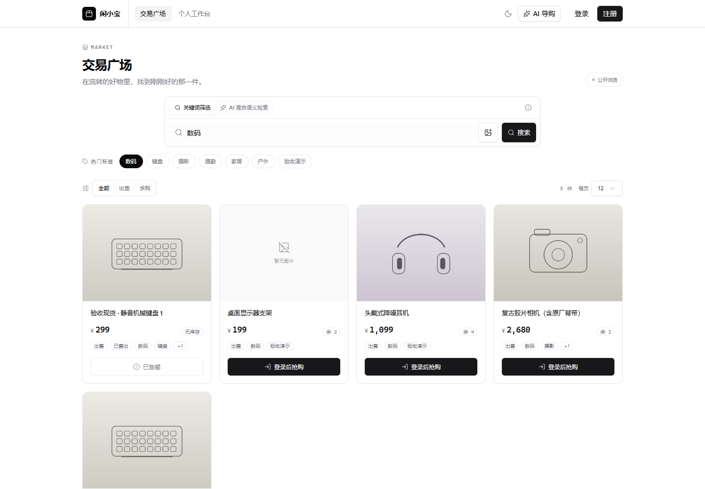

---

### 2.2 AI 混合语义检索（无向量 Key，自动回退 lexical）

**请求体（实测）：**

```json
{
  "query_text": "键盘",
  "include_wants": true
}
```

**响应（实测，节选）：**

```json
{
  "message": "为您找到与 '键盘' 相关的商品",
  "mode": "lexical",
  "data": [
    { "id": 17, "name": "验收现货 · 静音机械键盘 1", "score": 0.0164, "match_reason": "lexical", "is_offer": true },
    { "id": 13, "name": "机械键盘腕托",             "score": 0.0161, "match_reason": "lexical", "is_offer": true },
    { "id": 8,  "name": "机械键盘键帽套装",         "score": 0.0159, "match_reason": "lexical", "is_offer": true },
    { "id": 2,  "name": "求购机械键盘（青轴）",     "score": 0.0156, "match_reason": "lexical", "is_offer": false },
    { "id": 1,  "name": "静音机械键盘 87 键",       "score": 0.0154, "match_reason": "lexical", "is_offer": true }
  ]
}
```

**UI 判定：**

- 顶部状态条显示 `检索模式 lexical`、`命中 5 件`。
- 5 张卡片左上角均展示磨砂徽章：`关键词匹配 · 0.0164` / `0.0161` / `0.0159` / `0.0156` / `0.0154`。
- 返回结果包含求购帖，证明 `include_wants:true` 生效。
- 在结果上切换「求购」后，页面只在现有 Top-5 上本地过滤为 1 张卡片，**没有额外发起检索请求**（符合当前契约）。
- 无 `pageerror`；控制台仅出现预期的 503 资源日志（来自下一项以图搜图）。

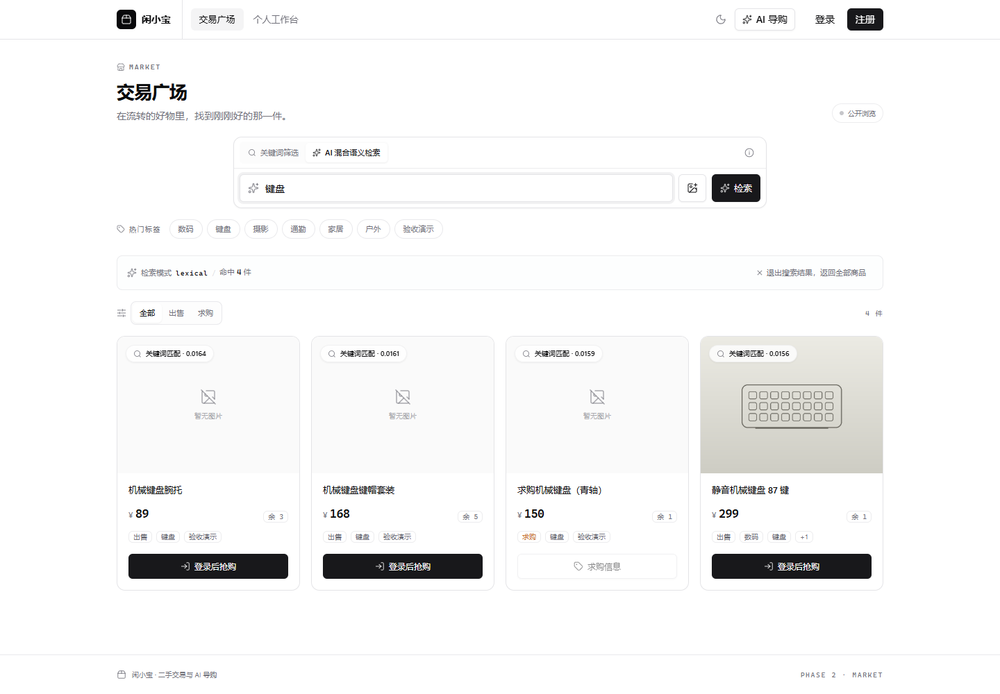

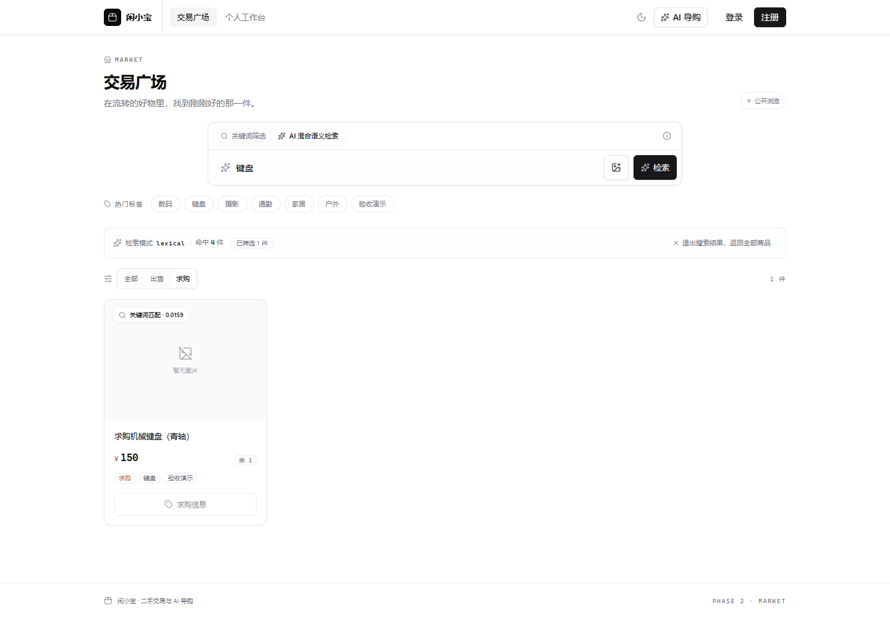

> 截图补充说明：`05/06` 摄于抢购用例之后，item 17 已售罄并被 lexical 的 `inventory > 0` 条件排除，因此截图显示 4 件；验收执行时该商品仍在售，实测响应为 5 件（见上方响应）。

---

### 2.3 以图搜图 503 降级

**请求与响应（真实后端，非 mock）：**

```http
POST /items/search-by-image
Content-Type: multipart/form-data
```

```http
HTTP/1.1 503 Service Unavailable
```

```json
{
  "error": {
    "code": "FEATURE_UNAVAILABLE",
    "message": "以图搜图功能在当前部署中不可用",
    "trace_id": "5b2cd1da9a654a07b0c4d1f46c834212",
    "details": {}
  },
  "detail": "以图搜图功能在当前部署中不可用"
}
```

**UI 判定：**

- 未出现红屏或未捕获异常。
- 搜索栏下方展示克制的提示条：「当前环境未启用视觉模型（CN-CLIP），建议改用 AI 语义描述检索。」
- 提供「切换到 AI 语义检索」按钮；点击后正确切到 AI 模式并清空图片预览。
- 图片缩略图与一键清空按钮均正常。

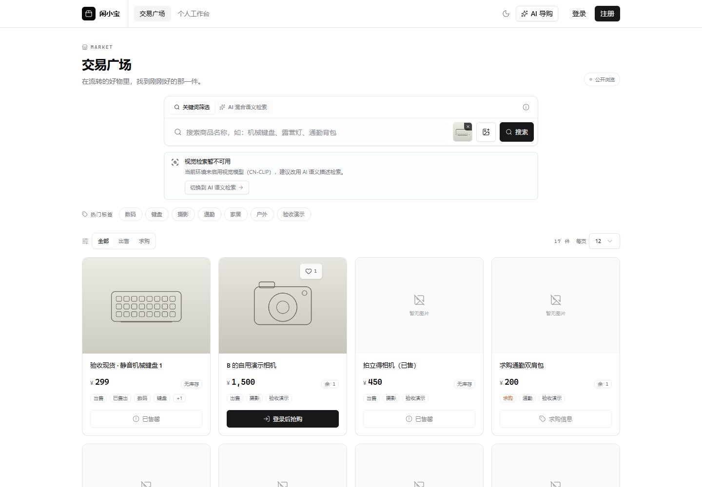

---

### 2.4 收藏与详情实时性

**操作链路：**

1. 以卖家 A 登录。
2. 搜索并打开买家 B 发布的「B 的自用演示相机」。
3. 点击心形按钮。

**Network 与响应（实测）：**

```http
POST /items/16/favorite
Authorization: Bearer <token>
```

```json
{
  "message": "收藏成功",
  "favorited": true,
  "favourited_count": 1
}
```

```http
GET /items/16
Authorization: Bearer <token>
```

```json
{
  "id": 16,
  "favorited": true,
  "favourited_count": 1
}
```

**UI 判定：**

- 点击后心形立即变为实心红色，卡片内收藏数显示 `1`。
- 详情弹窗打开时重新请求 `GET /items/16`，底部按钮显示「已收藏 1」。
- 刷新页面后重新进入该商品：列表接口返回 `favorited=true`、`favourited_count=1`，心形仍为实心，数量仍为 `1`。
- 切换到买家 B 登录后，同一商品接口返回 `favorited=false`、`favourited_count=1`：B 看到的是空心心形 + 公开计数 `1`，证明按当前用户回填与账号切换清空逻辑均正确。

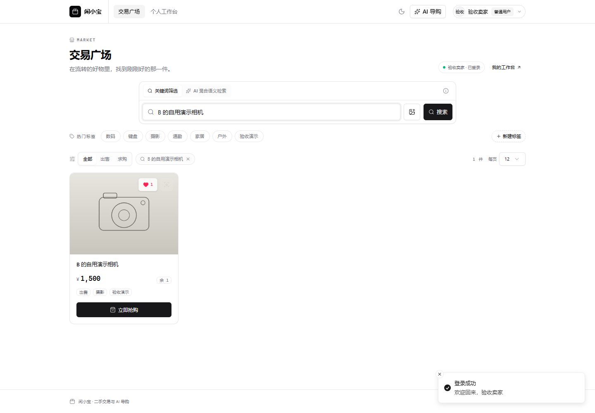

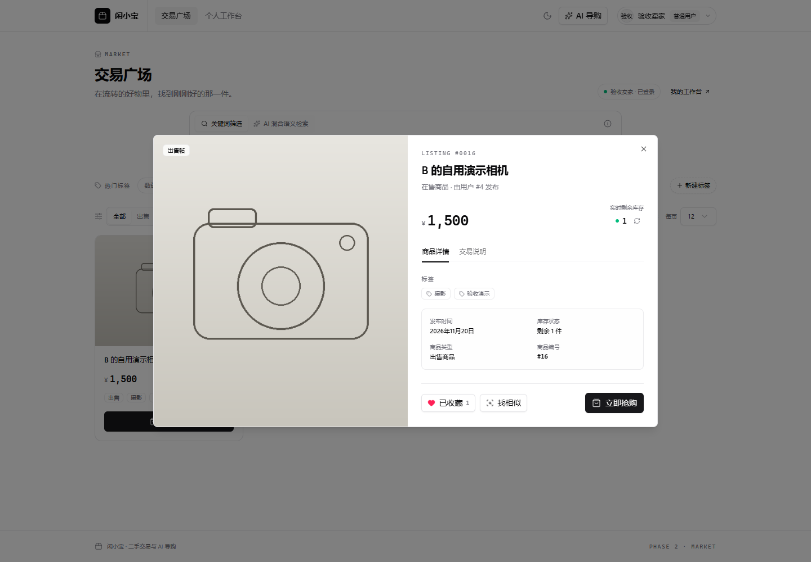

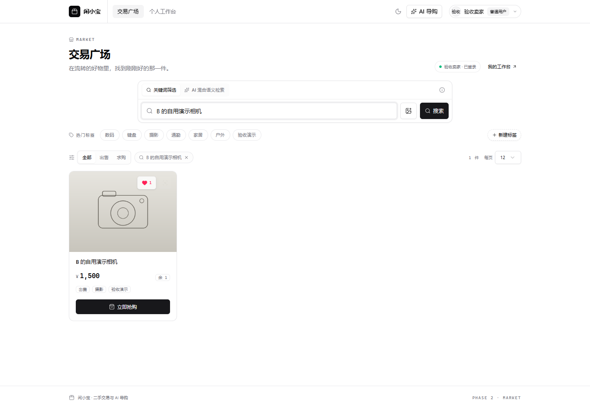

---

### 2.5 防超卖幂等抢购

**前置状态：** 买家 B 已登录；A 的「验收现货 · 静音机械键盘 1」库存为 1；B 自己发布的「B 的自用演示相机」按钮显示「我的发布」且处于禁用态。

**确认弹窗：**

- 展示商品缩略图、单价 ¥299、数量 1、当前库存 1。
- 「防重复提交保障」区域显示固定生成的 `X-Idempotency-Key`。
- 点击「查看 Key」后完整值：

```text
519ebc44-1673-49a4-9d35-f6886f81b817
```

**实际购买请求：**

```http
POST /items/17/buy
Authorization: Bearer <token>
X-Idempotency-Key: 519ebc44-1673-49a4-9d35-f6886f81b817
```

```json
{
  "order_id": 1,
  "item_name": "验收现货 · 静音机械键盘 1",
  "unit_price": 299,
  "quantity": 1,
  "remaining_inventory": 0,
  "message": "抢购成功！订单 #1 已生成，已售罄"
}
```

**断言结果：**

- 请求头 `X-Idempotency-Key` 与弹窗展示的 Key 完全一致。
- 成功回执显示订单号 `#1`、剩余库存 `已售罄`。
- 关闭回执后，卡片：
  - 库存标签变为「无库存」；
  - 商品状态增加「已售出」；
  - 主按钮变为「已售罄」且 `disabled=true`。
- 随后 `GET /items/17` 返回 `inventory=0`、`is_sold=true`。
- B 自己的发布按钮为「我的发布」且禁用，点击不会发起购买。
- B 的收藏视角仍为 `favorited=false` / `favourited_count=1`（A 的收藏计数公开可见）。

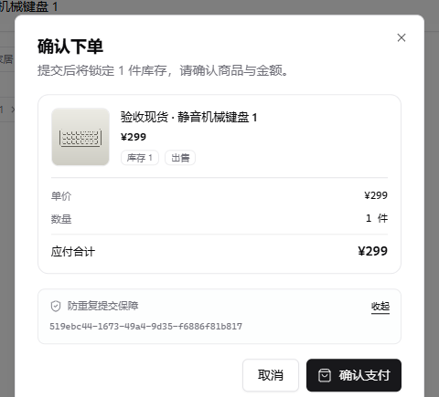

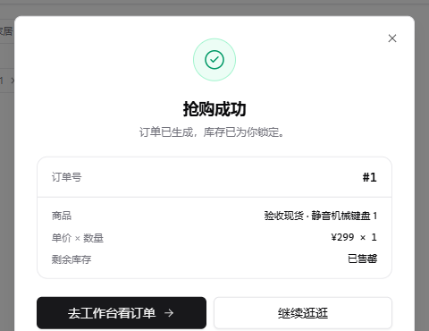

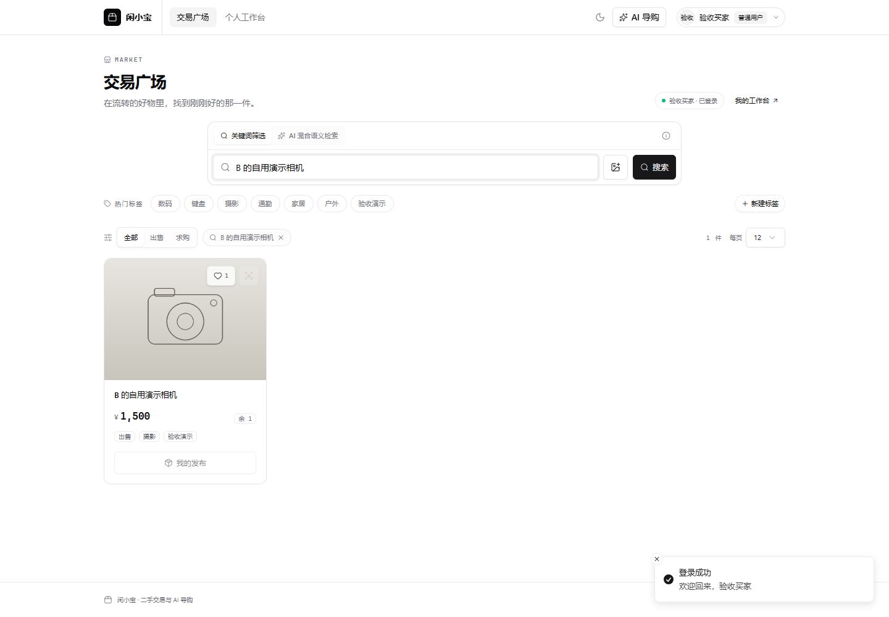

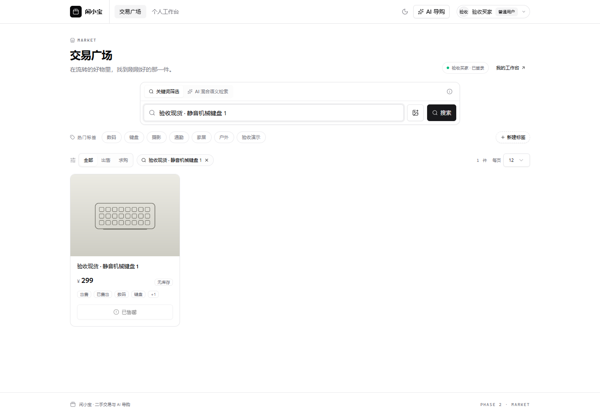

---

## 3. 验收中发现并修复的问题

### 3.1 检索结果中的缓存图片不显示

**现象：** 首次浏览时图片正常；切到 AI 检索结果、翻页或重新搜索后，同一张已缓存的图片区域保持空白（`` 已 `complete` 且 `naturalWidth>0`，但 `opacity` 仍为 `0`）。

**原因：** 缓存命中时 `` 可能在 React 挂载 `onLoad` 监听之前就已完成加载，`onLoad` 不再触发，`imageLoaded` 状态未更新。

**修复：** [ItemCard.tsx](../src/features/market/ItemCard.tsx) 增加 `imageRef`，在 `item.image_path` 变化后的 effect 中主动检查 `img.complete && img.naturalWidth > 0`，兜底设置已加载状态。修复后已在检索结果、翻页、详情等场景复核图片正常显示。

### 3.2 验收辅助改动

| 文件 | 改动 | 原因 |
| --- | --- | --- |
| [ItemCard.tsx](../src/features/market/ItemCard.tsx) | 心形按钮旁展示公开收藏数 | 让门禁 4 的「数量实时切换」在列表卡片上可直接看到 |
| [market-utils.ts](../src/features/market/market-utils.ts) | semantic / lexical 徽章展示 `score`；RRF 小分值保留 4 位小数 | 让门禁 2 的 `match_reason + score` 同时可见；避免 0.0164/0.0161 被四舍五入成同一个 0.02 |

## 4. 最终自检

```text
npm run typecheck
> tsc --noEmit
[typecheck exit: 0]

npm run build
> tsc --noEmit && vite build
✓ 2325 modules transformed.
✓ built in 988ms
[build exit: 0]
```

构建仅保留既有的非阻断提示：`Some chunks are larger than 500 kB after minification`。

> 后端 `pytest / ruff / mypy` 的结果记录在 [INTEGRATION-REPORT.md](./INTEGRATION-REPORT.md)；本次前端验收未重复执行后端全量测试，只通过真实 HTTP 请求验证接口契约与浏览器交互。

## 5. 复现方式

1. 确认后端运行在 `http://localhost:8000`，且 `.env` 中 `VISION_ENABLED=false`（503 用例需要）。
2. 确认前端 dev server 运行在 `http://127.0.0.1:5173`。
3. 匿名打开 `/market`，用「验收演示」标签可快速定位演示商品。
4. 门禁 4 使用卖家验收账号登录并搜索「B 的自用演示相机」。
5. 门禁 5 使用买家验收账号登录；当前 item 17 已售罄，复跑前需新建一件库存为 1 的他人出售商品。

## 6. 已知边界

- `POST /items/search-by-text` 仍只返回 Top-5；交易类型筛选是在这 5 条上本地过滤，可能显示「当前筛选下没有结果」。这是当前契约下已确认的行为。
- AI 模式点击标签仍作为语义检索词，不执行精确 `tag_id` 过滤；精确标签筛选请使用浏览模式。
- 以上验证针对 Phase 2 交易广场；Phase 3（AI Copilot）与 Phase 4（Studio/Admin）未在本轮验收范围内。
