# Phase 3 AI 导购 Copilot · 人工验收报告

> **结论：5/5 场景通过。** 真实后端、真实账号、真实 LLM 流式链路，无 mock；另完成 409 竞争条件与 CORS/SSE 响应头的补充验证。
>
> 验收过程中发现 2 个**非阻断**的后端/索引边界，已在第 4 节记录；本轮按约束**未修改任何后端代码**。

| 项目 | 信息 |
| --- | --- |
| 验收时间 | 2026-11-21 11:22:24 — 11:47（Asia/Shanghai） |
| 前端地址 | `http://127.0.0.1:5173`（Vite dev server，API base `http://localhost:8000`） |
| 后端地址 | `http://localhost:8000`（FastAPI `src.main:app --reload`，运行中） |
| 数据库 | 运行时实际落库为 SQLite `fastapi-practice-jzp/test.db`；审批与订单跨请求持久化正常 |
| 模型 | `deepseek-flash`（真实调用；`.env` 未单独设 `CHAT_API_KEY`，`Settings.chat_api_key` 回退到已配置的 `DEEPSEEK_API_KEY`） |
| 风控阈值 | `AGENT_APPROVAL_THRESHOLD=1000` |
| 浏览器 | Chrome headless 157 × Playwright 1.65.1，1440 × 1000，`zh-CN`，`Asia/Shanghai` |
| 执行方式 | Playwright 驱动真实 Chrome；真实登录、真实 SSE、真实审批接口；非 mock |
| 页面异常 | 主验收运行 `pageerror=0`、`console error=0` |
| 总判定 | **PASS 5/5** |

> 前端 API 契约与后端实现细节见 [INTEGRATION-REPORT.md](./INTEGRATION-REPORT.md)。本报告只记录验收执行、证据与边界，不重复后端实现说明。
>
> 验收脚本为临时脚本，执行后已清理；本报告与截图是本轮唯一新增产出。本轮验收未修改前后端源码。

---

## 0. 验收账号与数据

| 角色 | 用户名 | 邮箱 | 密码 | user_id |
| --- | --- | --- | --- | --- |
| 买家 B（验收操作账号） | 验收买家 | `p2accept.mwp4lzxg.buyer@example.com` | `Acceptance#2026` | 4 |
| 卖家 A（高价商品归属） | 验收卖家 | `p2accept.mwp4lzxg.seller@example.com` | `Acceptance#2026` | 3 |

关键商品：

| 商品 | item_id | 归属 | 单价 | 验收用途 | 验收后库存 |
| --- | --- | --- | --- | --- | --- |
| 头戴式降噪耳机 | 7 | 卖家 A | ¥1,099 | 门禁 3：批准并下单 | 4 → **3** |
| 复古胶片相机（含原厂背带） | 3 | 卖家 A | ¥2,680 | 门禁 4：拒绝；409 竞争 | **2**（未变） |
| 静音机械键盘 87 键 / 键帽套装 / 腕托 | 1 / 8 / 13 | 卖家 A | ¥299 / ¥168 / ¥89 | 门禁 1：键盘检索 | 未变 |
| 验收高价 · 便携投影仪 | 18 | 卖家 A | ¥1,599 | 临时检索对照，验收后已删除 | — |

审批与订单结果（只读核对 SQLite `agent_approvals` / `orders`）：

| approval_id | thread_id | 商品 | 数量 | 金额 | 结果 | 用途 |
| --- | --- | --- | --- | --- | --- | --- |
| 1 | `u4:p3purchase` | 相机 | 1 | ¥2,680 | rejected | 联调探针，清理 |
| 2 | `u4:main` | 耳机 | 1 | ¥1,099 | **approved → order #2** | 门禁 3 |
| 3 | `u4:main` | 相机 | 1 | ¥2,680 | rejected | 门禁 4 |
| 4 | `u4:main` | 相机 | 2 | ¥5,360 | rejected | 409 竞争测试 |
| 5 | `u4:main` | 相机 | 1 | ¥2,680 | rejected | 补拍真实待审批角标 |

- Order #2：buyer_id=4，item_id=7，price=1099，quantity=1，status=paid，`idempotency_key=approval:2`，地址「广东省广州市天河区体育西路100号」。
- 门禁 5 新线程：`u4:7f744bd8`，清空后服务端 history=0，F5 后仍为 0。
- 验收结束时全局 pending approvals = **0**。

---

## 1. 门禁总览

| # | 必测场景 | 结果 | 关键判定 | 证据 |
| --- | --- | --- | --- | --- |
| 1 | 流式渲染与工具可观测性 | ✅ PASS | `POST /items/ai/agent/stream` 头/体正确；意图胶囊、折叠/展开 ToolStepTimeline、Markdown 表格与代码块均正常 | 截图 01–04 |
| 2 | 上下文持久化与多轮记忆 | ✅ PASS | F5 后自动请求 `GET /items/ai/history?thread_id=u4:main&limit=50` 与 `GET /items/ai/threads/u4%3Amain/status`，历史完整回显 | 截图 05 |
| 3 | HITL 挂起 → 刷新恢复 → 批准闭环 | ✅ PASS | `interrupt_required` → 审批卡 + 输入锁 + Amber 角标；F5 卡片仍存；`resume` 返回 order_id=2；库存 4→3；角标清除 | 截图 06/06b、07、08、09、14 |
| 4 | 拒绝审批与 409 防重校验 | ✅ PASS | 拒绝返回 `order_id=null`、库存不变、输入解锁；外部先处理后再次点击批准得到 409，卡片降级为「已失效」且按钮消失、输入解锁、角标清除 | 截图 10、15 |
| 5 | 会话隔离与清空记忆 | ✅ PASS | 新线程不串入主会话历史/审批；`DELETE /items/ai/history?thread_id=...` 200，清空后及 F5 后均保持为空 | 截图 11–13 |

有效断言合计 **56 条**：主验收 **34/34**（另 1 条为测试脚本 URL 编码假设误报，见 3.2）、F5 复验 **3/3**、补拍 **6/6**、409 UI **13/13**。**产品行为失败 0 条。**

---

## 2. 后端对齐核对

### 2.1 CORS / SSE 代理缓冲

**真实预检（Playwright 之外以 Node fetch 发起）：**

```http
OPTIONS /items/ai/agent/stream HTTP/1.1
Origin: http://127.0.0.1:5173
Access-Control-Request-Method: POST
Access-Control-Request-Headers: authorization,content-type,accept,x-idempotency-key,x-thread-id,last-event-id
```

```http
HTTP/1.1 200 OK
Access-Control-Allow-Origin: http://127.0.0.1:5173
Access-Control-Allow-Headers: Accept, Accept-Language, Authorization, Content-Language,
  Content-Type, Last-Event-ID, X-Idempotency-Key, X-Request-ID, X-Thread-ID, X-Trace-ID
Access-Control-Allow-Methods: GET, POST, PUT, PATCH, DELETE, OPTIONS
```

**真实 SSE 响应头：**

```http
HTTP/1.1 200 OK
content-type: text/event-stream; charset=utf-8
cache-control: no-cache, no-transform
connection: keep-alive
x-accel-buffering: no
```

首帧即到达（68 bytes）：

```text
id: 1465-0
event: intent
data: {"intent": "chitchat", "tools": []}
```

浏览器侧同样正常：来自 `127.0.0.1:5173` 携带 6 个自定义头的跨域 POST 成功建立流，说明预检放行实际生效，而不是仅靠后端单测。

### 2.2 按 run 续传与幂等重放

前端请求实测（门禁 1 首轮）：

```http
POST /items/ai/agent/stream
Accept: text/event-stream
Content-Type: application/json
Authorization: Bearer <redacted>
X-Idempotency-Key: a953c4b3-1b1d-442f-88f9-bfda529ac420
X-Thread-ID: u4:main
Last-Event-ID: （首连不携带）
```

```json
{"message":"帮我找一下平台上的键盘","thread_id":"u4:main"}
```

- 请求体严格只有 `message`、`thread_id`，未携带本地历史数组。
- 前端每轮新对话生成一个 `X-Idempotency-Key`；重试同一句复用同一 Key；只有断线续传才追加 `Last-Event-ID`（`sseClient.ts`）。
- 后端本轮已把事件缓冲区改为 run 键（用户 id + Key），并覆盖“尾帧续传 / 缓存命中只返回 done / 游标越界补 done / 同会话下一轮隔离”；后端自测 220 passed、1 skipped。
- 前端 `sseClient.ts` 在开发期也做过 mock 流运行时断言：同 Key 重连、第二轮携带 `Last-Event-ID: 1`、4xx 不重连、用户 Abort 不重连。
- **边界（与后端说明一致）**：同键重试若在 worker 尚未 finalize 时到达，后端会把它当作“附着到运行中的流”，而不是缓存命中；前端继续用 `Last-Event-ID` 续传，不整段重放。本次验收未强行杀流做端到端断线演练，该分支由后端全量测试 + 前端 mock 断言覆盖。

### 2.3 审批 payload、时区、409 与 status 一致性

**SSE 原始 `interrupt_required` 帧（409 专项审批 4）：**

```json
{
  "approval_id": 4,
  "thread_id": "u4:main",
  "action": "create_order",
  "reason": "该订单金额超过自动授权额度，需要人工审核",
  "expires_at": "2026-11-22T03:43:26.523751+00:00",
  "payload": {
    "item_id": 3,
    "item_name": "复古胶片相机（含原厂背带）",
    "quantity": 2,
    "unit_price": 2680,
    "amount": 5360,
    "threshold": 1000,
    "address": "广东省广州市天河区体育西路200号"
  },
  "message": "这笔订单金额（￥5360.00）超过了自动授权额度，已提交人工审核。审核通过后会立即为您下单，请稍候。"
}
```

- `payload` 字段与后端约定完全一致：`item_name / quantity / unit_price / amount / threshold / address`（另含 `item_id`）。
- `expires_at` 为带时区的 `+00:00`；前端 `parseServerDate` 对 naive 字符串仍保留按 UTC 解析的兜底，但正常路径不再依赖兜底。
- 审批卡倒计时实测显示 `23:59:59`（基于 `expires_at` 的 24h 有效期），数字均为 `font-mono tabular-nums`。
- 409 实测响应：

```json
{
  "error": {
    "code": "CONFLICT",
    "message": "该审批已被处理",
    "trace_id": "36a42f7575e944fdbf3f14d773f2e529",
    "details": { "approval_id": 4, "status": "rejected" }
  },
  "detail": "该审批已被处理"
}
```

- 前端收到 409 后：卡片切换为「该审批已失效或已被处理」、隐藏批准/拒绝按钮、立即刷新 `status` 与全局 `approvals`、角标清零、输入框解锁（截图 15）。
- `GET /threads/{id}/status` 的 `is_interrupted` 只统计当前用户当前会话的 pending；本次刷新恢复、409 前后 `pending_approvals` 与 `GET /items/ai/approvals` 均一致。两个接口逐字段比较由后端测试覆盖。

---

## 3. 逐项验收证据

### 3.1 门禁 1：流式渲染与工具可观测性

**操作：** 登录买家 B → `Ctrl + J` 唤起 Copilot → 发送「帮我找一下平台上的键盘」→ 再发送「平台退换货与防骗规则是什么？」。

**请求：** 见 2.2；命中 `POST /items/ai/agent/stream`，`Accept: text/event-stream`，`X-Idempotency-Key`/`X-Thread-ID` 均存在，请求体只有 `message` + `thread_id`。

**SSE 事件（真实探针）：**

```text
event: intent
data: {"intent":"shopping_search","tools":["search_items","search_web_price"]}

event: tool_start
data: {"name":"search_items","arguments":{"query":"键盘","category":"键盘"}}

event: tool_end
data: {"name":"search_items","ok":true}

event: token
data: {"text":"老板","content":"老板"}
...
```

**补：** 流最终以 `done` 结束（真实探针中 `done` 帧形如 `data: {"steps":1}`）；前端以终态事件退出发送态，不依赖 `done` 的 `steps` 字段。

**UI 判定：**

- 意图胶囊：`意图 · 商品检索`；规划工具数展示 `2 TOOLS PLANNED`。
- 工具步骤默认折叠为单行胶囊：中文名「检索平台在售商品」+ 技术名 `search_items` + 绿色完成图标；点击后展开 `ARGUMENTS` JSON（`query` / `category`），折叠态与展开态分别见截图 02 / 03。
- 规则咨询命中「查询平台交易规则」工具步骤（截图 04，实际模型连续调用了 3 次，均正确归并到同一 AI 消息）。
- 正文按 Markdown 渲染：列表、表格、行内代码、代码块复制按钮均正常；流式光标在正文末尾。
- 空状态 4 个快捷提问卡片正常（截图 01）。

**Network/页面：** 0 pageerror，0 console error。

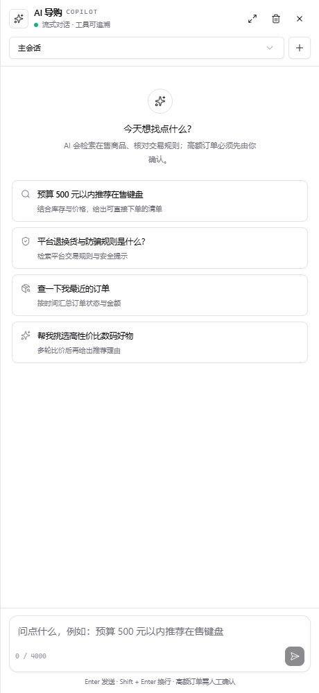

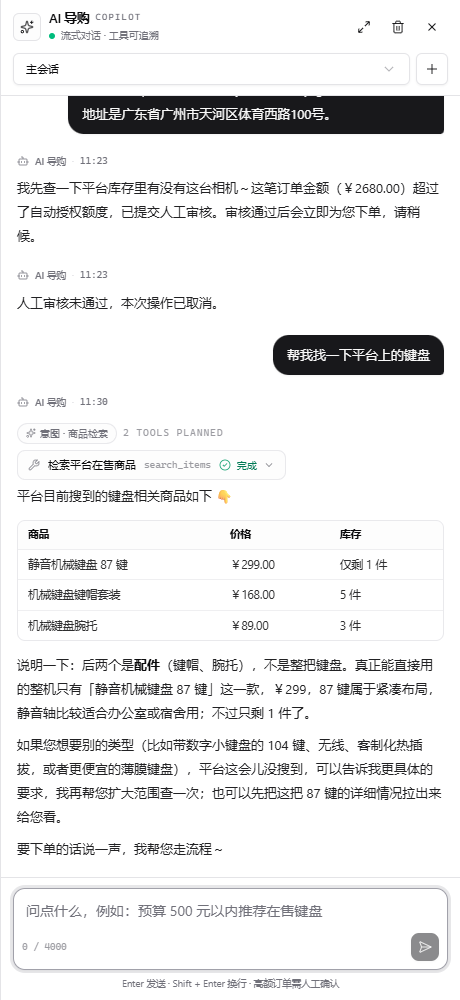

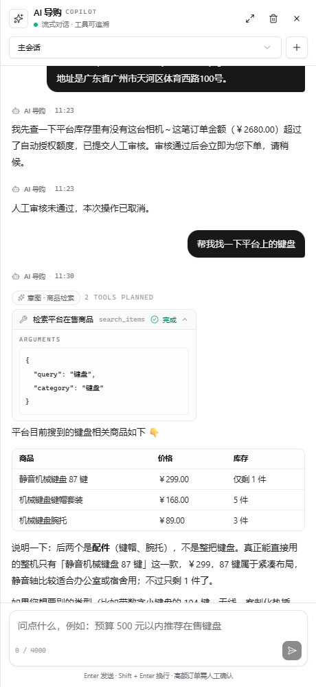

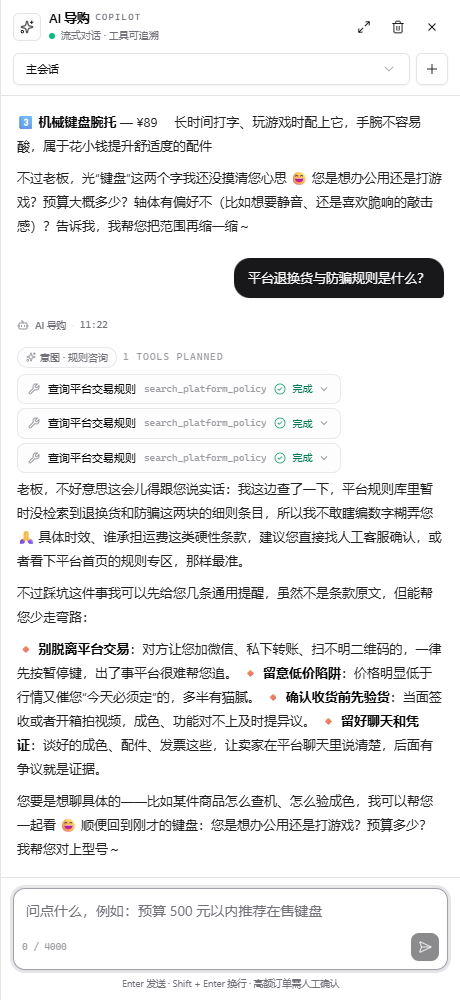

---

### 3.2 门禁 2：上下文持久化与多轮记忆（F5）

**操作：** 在已有两轮对话的主会话按 F5 → 重新打开 Copilot。

**Network（实测）：**

```http
GET /items/ai/history?thread_id=u4:main&limit=50    → 200
GET /items/ai/threads/u4%3Amain/status              → 200
```

**判定：** 历史消息完整回显（用户提问 + AI 回复）；`status` 返回 `is_interrupted=false`、`pending_approvals=[]`；抽屉打开时自动同步，不需要手动刷新。

> **一次测试脚本误报说明：** 主验收脚本最初用字面量判断 query 中冒号必须编码为 `%3A`，而实际请求为合法的 `thread_id=u4:main`（path 中的线程 id 仍按 `encodeURIComponent` 编码为 `u4%3Amain`）。已改为 `URLSearchParams` 解析并单独复验：`thread_id=u4:main`、`limit=50` 全部通过（3/3）。这不是产品缺陷。

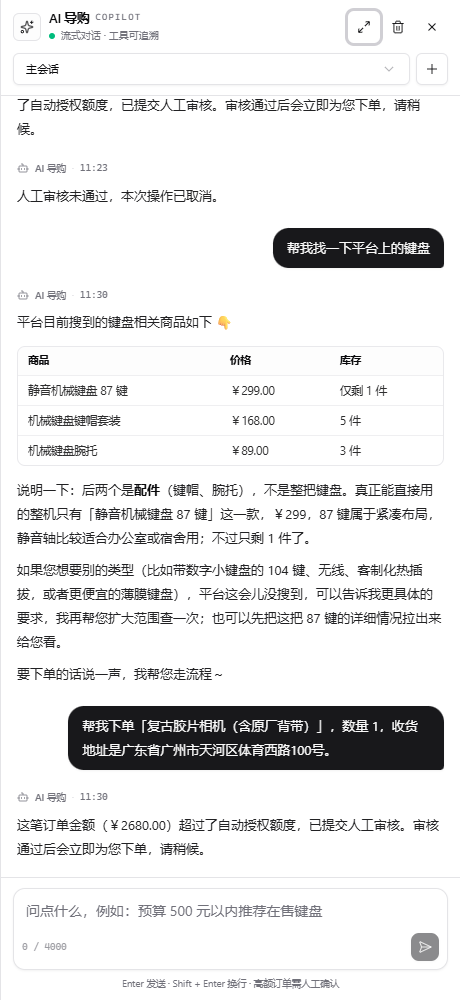

---

### 3.3 门禁 3：HITL 挂起 → 刷新恢复 → 批准闭环

**操作：** 发送「帮我下单『头戴式降噪耳机』，数量 1，收货地址是广东省广州市天河区体育西路100号。」

**挂起态（截图 06 / 06b）：**

- 收到 `interrupt_required` 后流结束；审批卡内嵌在消息流底部，展示：
  - 商品「头戴式降噪耳机」；
  - 数量 `1`、单价 `¥1,099.00`、总金额 `¥1,099.00`、触发阈值 `¥1,000.00`；
  - 收货地址「广东省广州市天河区体育西路100号」；
  - 审批原因「该订单金额超过自动授权额度，需要人工审核」；
  - 倒计时 `23:59:59`；
  - 可选备注输入框 + 「批准并下单」/「拒绝操作」。
- 输入框进入锁定态：禁用 + 提示「当前会话有待审批的高额订单，请先在上方卡片完成审批」。
- 顶栏「AI 导购」出现 Amber 角标 `1`（截图 06 中抽屉遮住按钮，故另拍截图 14：关闭抽屉后可见角标；这是一笔真实 pending 审批）。
- 待审批队列条显示「待审批队列 1」及可跳转的审批摘要。

**F5 恢复：** 刷新页面 → 重新打开 Copilot → 审批卡仍在（由 `GET /threads/{id}/status` 的 `pending_approvals` 恢复），倒计时继续，输入框仍锁定（截图 07）。

**批准：**

```http
POST /items/ai/threads/u4%3Amain/resume
Content-Type: application/json

{"approved":true,"approval_id":2}
```

```json
{"status":"approved","approval_id":2,"thread_id":"u4:main","order_id":2}
```

- 卡片切换为「已通过」，展示「订单 #2」并链到 `/studio`；消息流出现「人工审核已通过，订单 #2 已创建。」（截图 08）。
- 全局 `approvals` 与角标立即刷新，角标清零；输入框解锁。
- `GET /items/7` 库存 `4 → 3`；交易广场卡片经 `market:inventory-changed` 静默刷新为「余 3」（截图 09），未出现骨架屏闪动。
- SQLite `orders` 核对：order #2，buyer_id=4，item_id=7，price=1099，status=paid，`idempotency_key=approval:2`。

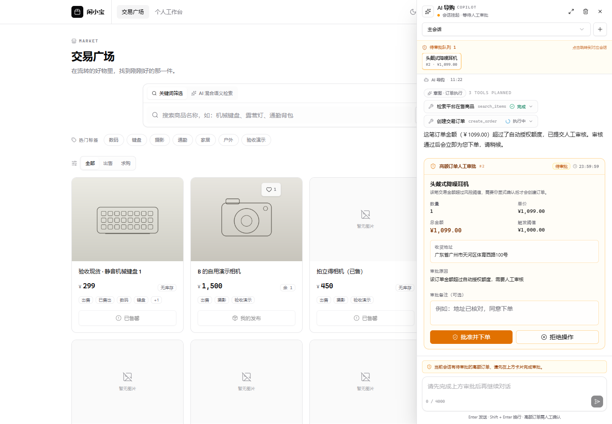

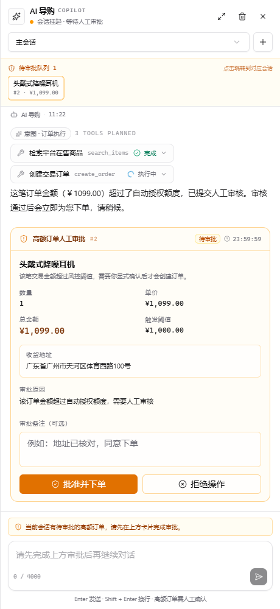

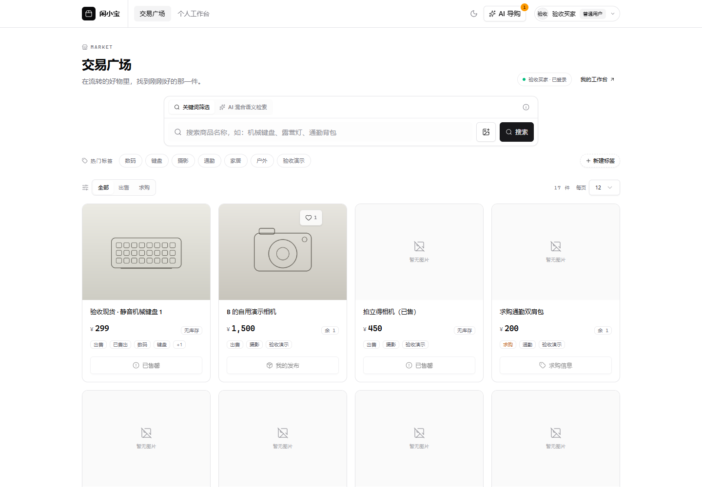

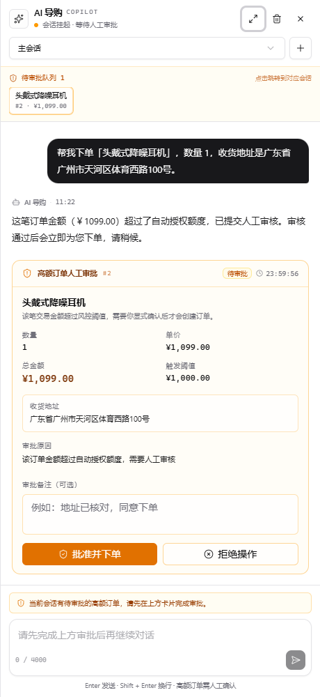

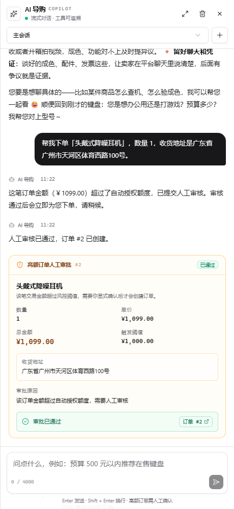

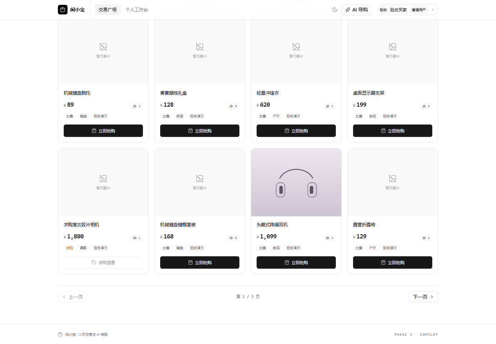

> `14b-approval-badge-trigger.png` 为按钮局部放大图，可放大核对 Amber 角标。

---

### 3.4 门禁 4：拒绝审批与 409 防重校验

#### 拒绝

**操作：** 再次触发高价订单（相机，¥2,680，数量 1）→ 点击「拒绝操作」。

```http
POST /items/ai/threads/u4%3Amain/resume
{"approved":false,"approval_id":3}
```

```json
{"status":"rejected","approval_id":3,"thread_id":"u4:main","order_id":null}
```

- 卡片显示「已拒绝，未创建订单」；输入框解锁；无新订单。
- 相机库存前后均为 `2`，未减少。
- 顶栏角标清零；当前会话 `is_interrupted=false`。
- 截图 10 右下角 Toast 为拒绝成功的即时反馈。

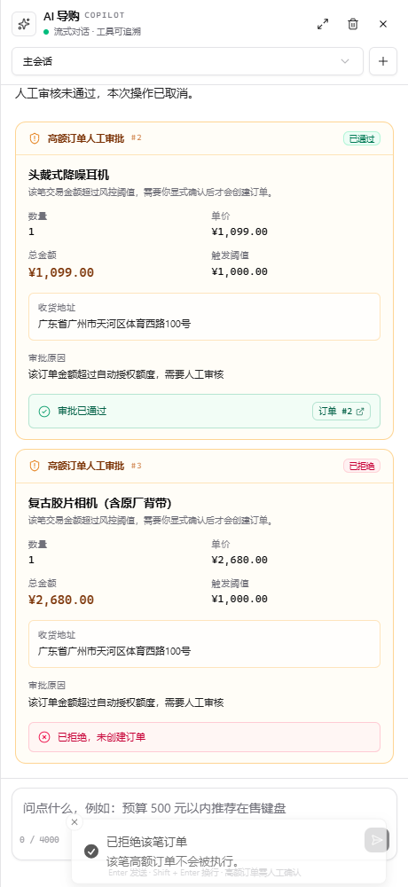

#### 409 竞争条件

为避免同一 payload 复用已终态审批（见 4.1），使用一笔**独立审批**：`item 3 × 2 + 体育西路200号`，金额 `¥5,360`，approval_id=4。

1. 通过 SSE 创建该待审批，刷新 UI 后卡片由 `status` 恢复。
2. 在页面之外先用同一账号 `resume` 拒绝该审批（`200 rejected`）。
3. 页面仍显示 pending 卡片，此时点击「批准并下单」。

实际结果：

```http
HTTP/1.1 409 Conflict
```

```json
{"error":{"code":"CONFLICT","message":"该审批已被处理","details":{"approval_id":4,"status":"rejected"}}}
```

UI 判定（截图 15）：

- 卡片降级为「已失效」+「该审批已失效或已被处理 / 该审批已被处理」。
- 批准/拒绝按钮全部消失（计数 `approve=0, reject=0`），不会卡死。
- Toast「审批未完成 · 该审批已被处理」。
- 立即刷新 status 与全局 approvals：pending=0、角标清零、输入解锁。
- 未创建订单，相机库存仍为 `2`。

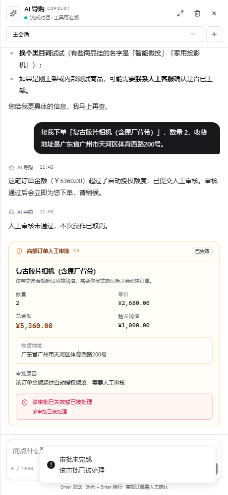

---

### 3.5 门禁 5：会话隔离与清空记忆

**新建会话：** 通过会话下拉「新建会话」创建 `u4:7f744bd8`（格式 `u4:{8位shortId}`，满足字母/数字/`-_:.` 且 ≤64 字符）。

- 新线程空状态与主会话互不串扰：无主会话历史、无审批卡（截图 11）。
- 发送「你好，这是新会话的隔离测试」，仅本线程消息可见。
- 切回主会话后历史/审批仍在。

**清空记忆：**

```http
DELETE /items/ai/history?thread_id=u4%3A7f744bd8 → 200
```

- 本地消息流、审批视图、`approvalDecisions` 一并重置；服务端 history 复查 `count=0`（截图 12）。
- F5 后通过下拉切回该线程：仍为空状态，服务端 history 仍为 `0`（截图 13）。
- 主会话未被清空。

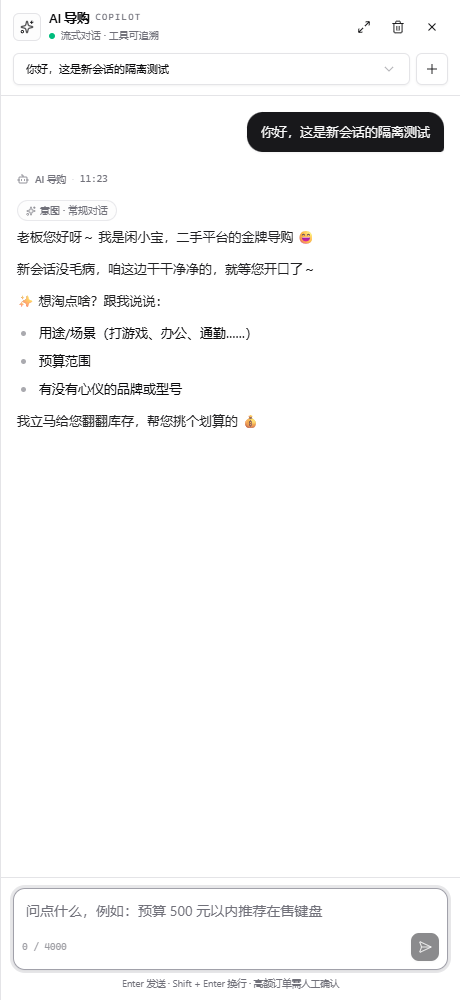

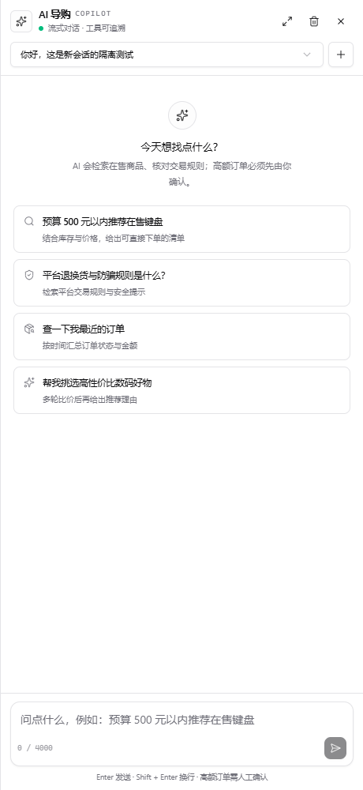

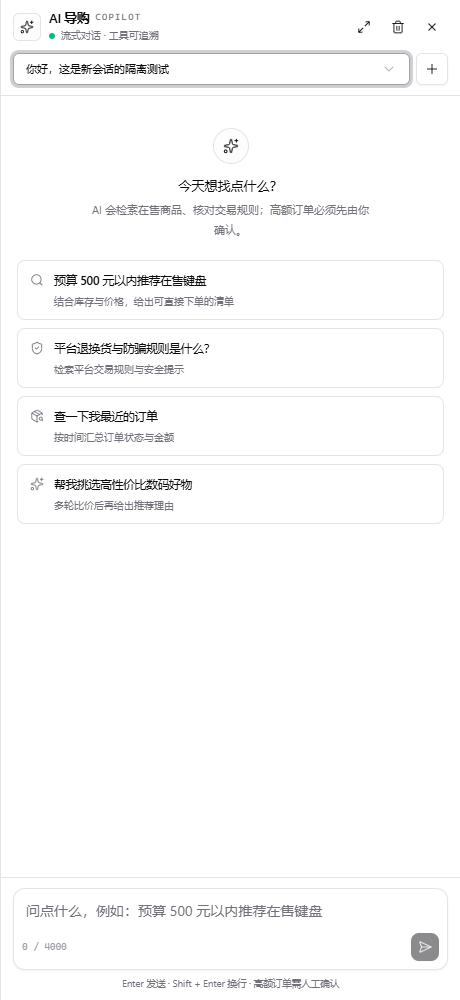

---

## 4. 验收中发现的边界（非阻断）

### 4.1 审批幂等键复用已终态审批，会产生短暂「幽灵卡」

**现象：** 在 `u4:main` 中重复提交**完全相同**的高额订单（相机 ×1 + 体育西路100号），后端审批 idempotency_key 复用已拒绝的 approval 3，但仍通过 SSE 发出 `interrupt_required`；此时 `GET /items/ai/approvals` 为空，UI 会短暂渲染一张 pending 卡片。

**证据：**

- approval 3 已 rejected，但重复下单的 SSE 仍携带该审批信息；随后该线程 `/approvals` 查不到 pending。
- 点击该卡片会走 409 分支（与 3.4 的 409 UI 测试同路径），卡片降级为「已失效」，不会重复下单。
- 本次真实待审批角标截图已改用独立审批 5 重拍，避免使用幽灵卡作为门禁 3 证据。

**影响：** 无数据损坏、无重复扣款；用户可能看到一张很快失效的卡片。

**建议（不属本轮改动）：**

- 后端在复用已终态审批时，直接返回 `done` 或 409 终态事件，而不是 `interrupt_required`；
- 或前端收到 `interrupt_required` 后与 `/approvals` 对账，再决定是否渲染 pending 卡；
- 复跑验收时请使用**不同 item / 数量 / 地址**，确保生成新的 approval idempotency_key。

### 4.2 新建无图商品可被公开检索命中，但 agent `search_items` 返回 0

**现象：** 临时创建 item 18「验收高价 · 便携投影仪」（¥1,599、库存 1、无图片）。公开接口可以命中，但 AI 回复「平台在售库存里查不到这款商品」，最终未触发审批。

**公开检索实测：**

```http
GET /items?search=便携投影仪            → total=1，命中 item 18
POST /items/search-by-text              → mode=lexical，命中 item 18
       {"query_text":"便携投影仪","include_wants":true}
```

**影响：** 刚上架、尚未进入检索索引（或缺少图片 embedding）的商品，可能暂时对 AI 工具不可见；公开浏览与检索不受影响。门禁 3/4 使用既有索引内商品完成。

**建议：** 确认 `search_items` 工具的过滤条件与索引同步机制（是否要求 `image_path`/embedding），补上架后重索引或 lexical 兜底；验收新商品时优先使用已入库一段时间的商品。

### 4.3 其他已知行为（符合当前设计）

- **F5 后当前线程重置为主会话**：线程列表通过 localStorage 持久化，但当前激活线程不持久化；清空用例通过下拉切回新线程验证为空。这是当前实现的既定行为，不影响历史/审批持久化。
- **工具步骤不随 history 回放**：后端 `ChatRecord` 只存消息文本，F5 后只恢复正文与审批卡（由 status 恢复），不恢复 ToolStepTimeline。门禁 2 只要求历史与 status，已满足。
- **SSE 断线重连未做端到端杀流演练**：本次验收聚焦 5 个 UI/业务门禁；断线续传由后端 220 项测试与前端 `sseClient` mock 断言覆盖，真实浏览器路径未强制断网。
- **模型正文中的表情符号**来自 LLM 输出，不属于 UI 图标；UI 图标全部为 `lucide-react` 线性图标（全局 `stroke-width: 1.5`），未使用 Emoji 作为界面图标。

---

## 5. 验证记录

### 5.1 前端门禁

```text
> npm run typecheck
> tsc --noEmit
[exit 0，0 errors]

> npm run build
> tsc --noEmit && vite build
✓ 2584 modules transformed.
dist/assets/index-BIZvkQEl.css   93.58 kB │ gzip: 14.98 kB
dist/assets/index-Cl1lf7Vq.js   871.81 kB │ gzip: 270.28 kB
✓ built in 832ms
[exit 0]
```

构建仅保留既有的非阻断提示：`Some chunks are larger than 500 kB after minification`。

### 5.2 浏览器运行

| 指标 | 结果 |
| --- | --- |
| Playwright 断言 | 主验收 34/34（1 条脚本编码假设误报已修正复验 3/3）、补拍 6/6、409 UI 13/13 |
| `pageerror` | 0 |
| Console error | 0 |
| 审批/订单一致性 | pending 最终 0；order #2 唯一新增订单；item 7 4→3；item 3 2→2 |

### 5.3 后端

后端侧提供的本轮结果（本轮未修改后端，也未重复运行全量后端测试）：

```text
pytest: 220 passed, 1 skipped
ruff check / ruff format --check / mypy: 全部通过
```

覆盖：断线尾帧续传、缓存命中只回 done、游标越界、同会话下一轮隔离、SSE 预检、审批 payload/时区/409 一致性、`is_interrupted` 与两接口字段一致。

---

## 6. 交付物与测试数据状态

### 6.1 新增文件

| 文件 | 说明 |
| --- | --- |
| `docs/PHASE3-ACCEPTANCE-REPORT.md` | 本报告 |
| `docs/assets/phase3-acceptance/01…15*.png` | 17 张验收截图（含 14b 按钮局部图） |

### 6.2 未修改

- **后端**：`D:\Projects-practice\fastapi-practice-jzp` 下未修改任何源码/配置；仅通过公开 API 创建验收数据，并只读查询 SQLite 核对审批/订单。
- **前端**：本轮未修改 `src/` 下任何源码；Phase 3 实现与上一轮交付一致。
- **临时验收脚本/日志**：执行后已全部删除，未留在仓库。

### 6.3 测试数据残留（便于人工复核）

- 主会话 `u4:main` 保留验收对话历史（买家 B）；可在 Copilot 中「清空记忆」重置。
- 新线程 `u4:7f744bd8` 已清空，服务端 history=0。
- order #2 已创建（耳机，¥1,099）；item 7 库存为 **3**，item 3 库存为 **2**。
- 临时商品 item 18 已删除；市场恢复 17 件。
- approval 1–5 均已在 `agent_approvals` 留档（approval 2 为 approved，其余 rejected）。

---

## 7. 复现方式

1. 启动后端（`AGENT_APPROVAL_THRESHOLD=1000`，有效 LLM Key 或 `scripts/dev_llm_stub.py`），确认 `http://localhost:8000/health` 返回 ok。
2. 启动前端 `npm run dev`，确认 `http://127.0.0.1:5173/market` 可访问。
3. 用买家 B 登录，按 `Ctrl/Cmd + J` 打开 Copilot。
4. 依次执行门禁 1–5；HITL 用例需至少一件**他人发布、售价 ≥ ¥1,000、有库存**的在售商品。
5. 复跑批准用例前注意：item 7 已被买走 1 件（库存 3）；重复相同 payload 会复用旧审批，请换 item / 数量 / 地址，或新建高价商品并使用已进入检索索引的商品。
6. 验证 F5：刷新后重新打开 Copilot，观察 history/status 请求与审批卡恢复。
7. 409 用例：先让另一个客户端/接口处理掉某 pending 审批，再在原页面点击批准，观察卡片降级与按钮消失。

---

## 8. 结论

- **Phase 3 五个 AgentOps 门禁全部通过（5/5）**；核心的「高额订单挂起 → F5 恢复 → 批准下单 → 库存实时刷新」闭环在真实 LLM 与真实后端上验证成功。
- 前端 8 类 SSE 事件状态机已完整实现；本次真实链路实测覆盖 `intent`、`tool_start`、`tool_end`、`token`、`interrupt_required`、`done`，工具时间轴、审批队列/角标、409 防重、会话隔离与清空记忆均符合预期；无页面异常或控制台错误。`error` / `aborted` 分支由实现与构建期校验覆盖，本次未刻意制造上游故障。
- 两个非阻断边界（审批幂等键复用已终态记录、新商品 AI 检索索引）已记录并给出建议，留待后端/索引侧评估，不影响本轮 Phase 3 验收结论。
