# Phase 4 个人工作台 / 管理控制台 · 实现与联调验收报告

> **结论：Phase 4 实现完成，5/5 验收门禁通过。**
>
> 本报告综合后端 [`FRONTEND-INTEGRATION.md`](../../fastapi-practice-jzp/docs/FRONTEND-INTEGRATION.md) 的三条硬契约、Phase 4 前端实现、以及真实 FastAPI + 真实 Chrome 的端到端验收证据。Phase 3 的 HITL 背景见 [`PHASE3-ACCEPTANCE-REPORT.md`](./PHASE3-ACCEPTANCE-REPORT.md)，前端历史契约修复见 [`INTEGRATION-REPORT.md`](./INTEGRATION-REPORT.md)。
>
> 验收期间**产品行为失败 0 条**。发现 1 个管理台布局问题并已修复；另记录 1 次验收脚本 URL 编码误报，不属于产品缺陷。

| 项目 | 信息 |
| --- | --- |
| 验收时间 | 2026-11-21 14:12 — 14:22（Asia/Shanghai） |
| 前端 | `http://127.0.0.1:5173`（Vite dev server） |
| 后端 | `http://127.0.0.1:8000`（`uvicorn src.main:app --reload`） |
| 数据库 | SQLite `fastapi-practice-jzp/test.db`（运行时实际落库） |
| 后端版本 | `0.2.0`（`GET /health/ready` 实际返回值） |
| 环境 | `development` |
| 视觉模型 | `VISION_ENABLED=false`（验证 AI 识图降级路径） |
| 审批阈值 | `AGENT_APPROVAL_THRESHOLD=1000` |
| LLM | `deepseek-flash`（真实调用，非 mock） |
| 浏览器 | Chrome headless 157 × Playwright 1.65.1，1440 × 1100 / 1200 |
| 页面异常 | 主验收 `pageerror=0`，`console error=0` |
| 构建 | `typecheck` 0 errors；最大单 chunk **245.27 kB** |
| 总判定 | **PASS 5/5** |

---

## 0. 验收结论速览

| # | 必测场景 | 结果 | 关键判定 |
| --- | --- | --- | --- |
| 1 | 发布 + AI 识图降级 + `tag_ids` 自动创建 | PASS | `analyze-upload` 200 且回显图片；`suggested_tags=[]` 正常降级；新标签 201；`POST /items` 201 且仅 6 个白名单字段；KPI `published_count 1→2` |
| 2 | 编辑回填完整性（防截断覆盖） | PASS | 点击编辑先 `GET /items/19` 200；库存、图片、标签完整回填；`PUT /items/19` 200，价格 288→299，无 422 |
| 3 | 订单与审批收件箱三端同步 | PASS | order #2 正确渲染；审批 #7 批准后 `order_id=5`；顶栏角标、Tab 角标、Copilot 队列全部归零；order #5 出现在「我的订单」 |
| 4 | Admin 权限与运维探针闭环 | PASS | `health/ready` 展示 database 延迟、环境、版本；用户 #5 角色 `user→admin→user`；标签创建 201、删除 204；自我降级强提醒可见 |
| 5 | 代码分包验证 | PASS | 路由懒加载 + vendor 分包；最大 chunk 245.27 kB；无 870 kB+ 单包、无 500 kB 告警 |

**对应截图：**

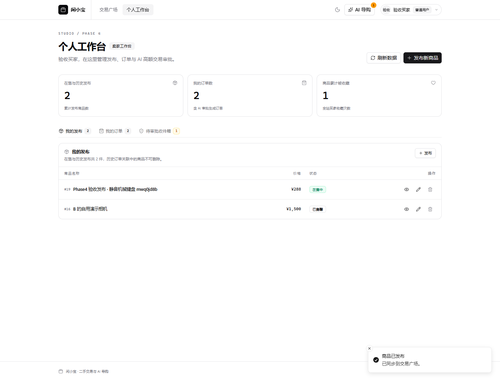
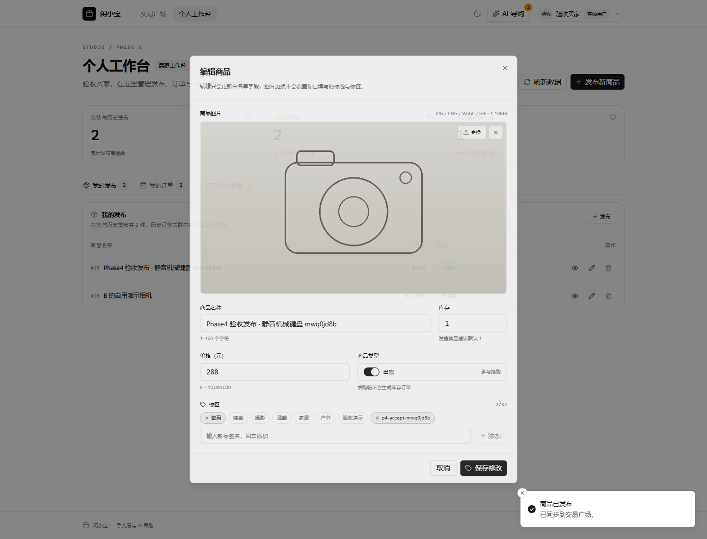
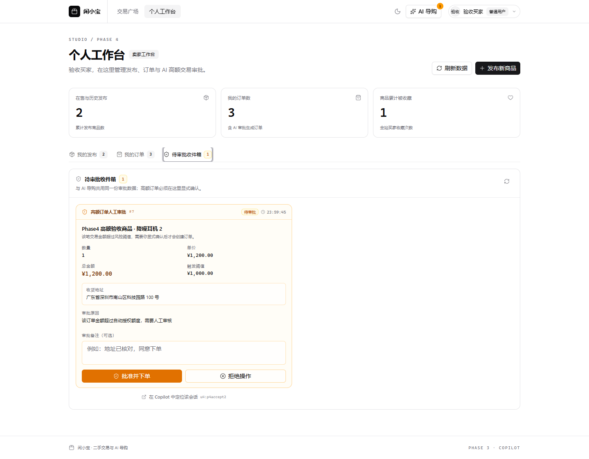
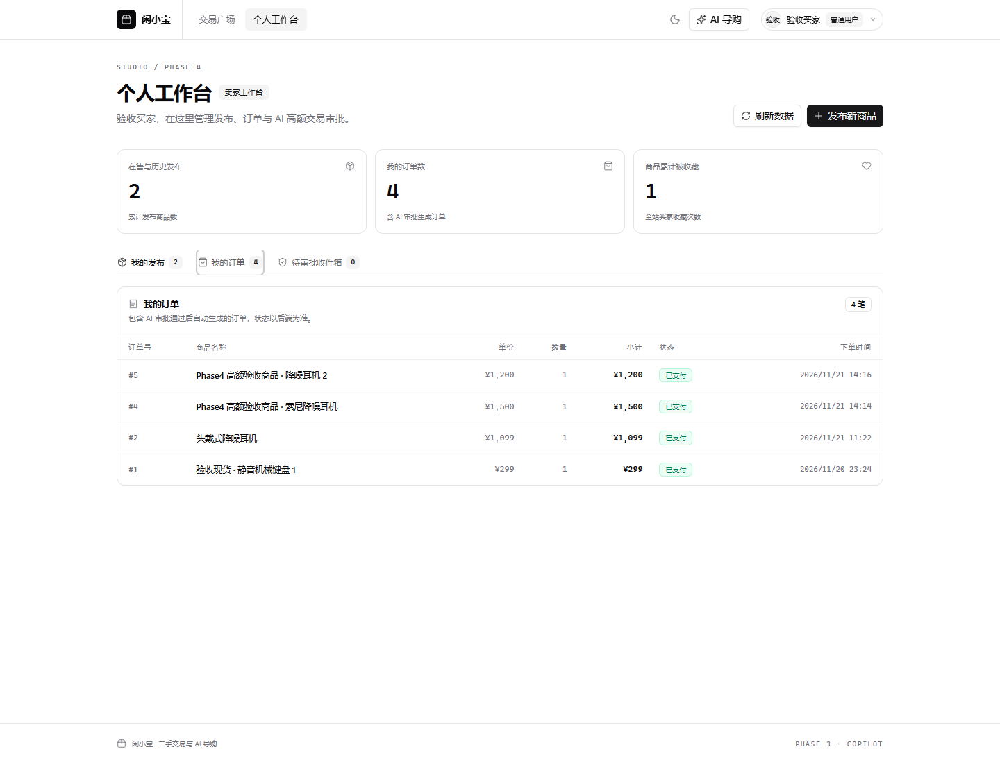
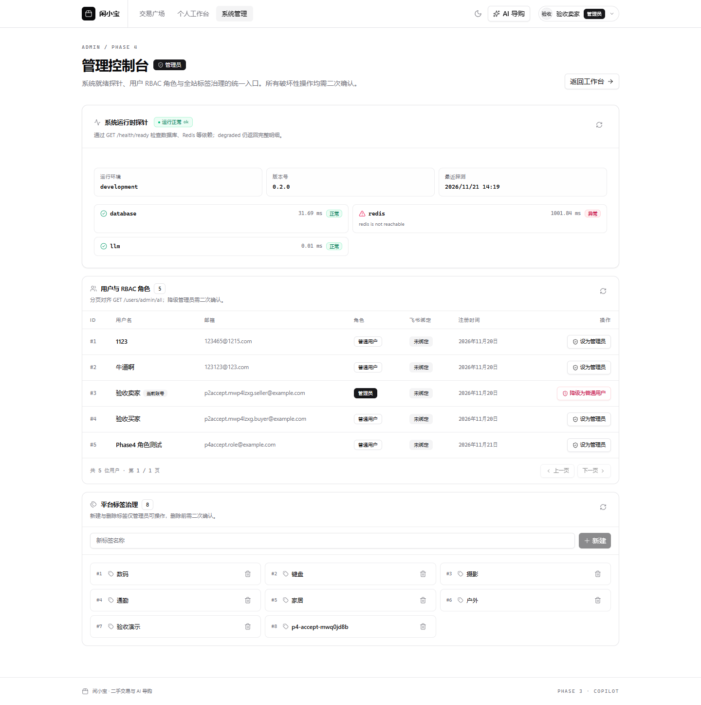
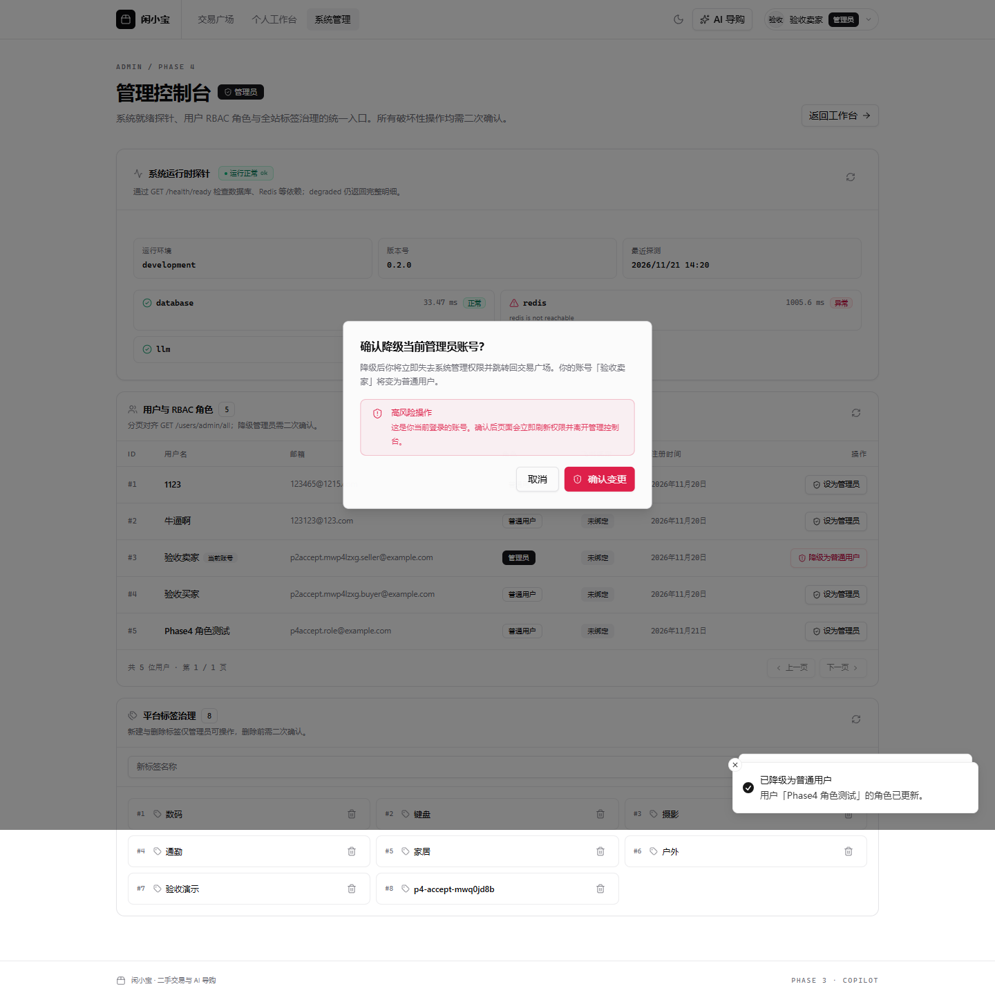

---

## 1. Phase 4 交付范围

### 1.1 个人 / 卖家工作台（`/studio`）

所有已登录用户（`user` 与 `admin`）均可访问，数据由 `GET /items/dashboard/me` 与 `useAgentStore` 驱动。

- **Bento KPI 三列**：在售与历史发布、我的订单数、商品累计被收藏；大号 `font-mono tabular-nums` 数字 + 1px 细边框 + 线性图标。
- **我的发布**：商品名称、价格、状态徽章、预览 / 编辑 / 删除。
  - 编辑前必须 `GET /items/{id}` 获取完整 `ItemRead`，避免用 dashboard 残行覆盖库存 / 图片 / 标签。
  - 删除使用 `AlertDialog`；若后端因 `orders.item_id RESTRICT` 返回 409，原样展示后端可读 message。
  - 成功后刷新 Dashboard 并派发 `market:inventory-changed`。
- **我的订单**：订单号、商品、单价、数量、小计、状态徽章、下单时间本地化；空状态一键跳转交易广场。
- **待审批收件箱**：直接复用 Phase 3 `ApprovalCard` 与 `decideApproval`；挂载时 `fetchGlobalApprovals()`；Tab 角标读取 `pendingApprovals.length`；支持在 Copilot 中定位对应 `thread_id`；批准后自动刷新 Dashboard。
- **发布 / 编辑弹窗**：图片上传、AI 自动打标、标签多选 / 新建、`resolveTagIds`、严格白名单载荷、创建幂等键、完整表单校验。

### 1.2 管理员控制台（`/admin`）

仅 `user.role === 'admin'` 可访问，页面内部仍对非管理员优雅降级。

- **系统运行时探针**：`GET /health/ready`，展示环境、版本、整体状态、各依赖徽章与毫秒延迟，支持手动刷新。
- **用户与 RBAC**：`GET /users/admin/all?skip=...&limit=20`，严格对齐 `PageResponse<UserAdminView>`；当前账号徽章、角色徽章、飞书绑定、注册时间、角色切换。
- **标签治理**：全站标签列表、新建、删除；删除需 `AlertDialog` 二次确认。
- **安全护栏**：管理员将**自己**降级为 `user` 时弹出强提醒；确认成功后 `useAuthStore.getState().hydrate(true)` 强制刷新角色，并跳转交易广场。

### 1.3 工程优化

- 5 个页面改为 `React.lazy` 路由懒加载，统一 `Suspense` 骨架回退，`AppShell` 不卸载。
- `vite.config.ts` 使用 `manualChunks` 分离 `react-vendor`、`markdown-vendor`、`lucide-vendor`、`radix-vendor`、`vendor`。
- 实测最大单 chunk 从原先 871,817 B 降至 **245.27 kB**。

### 1.4 新增 / 修改文件

**新增**

| 文件 | 说明 |
| --- | --- |
| `src/components/ui/table.tsx` | shadcn Table |
| `src/components/ui/switch.tsx` | 基于 Radix Switch |
| `src/components/ui/alert-dialog.tsx` | 基于 Radix AlertDialog |
| `src/features/studio/studio-utils.ts` | 订单状态、标签解析、表单校验 |
| `src/features/studio/MyItemsTable.tsx` | 我的发布 / 预览 / 编辑 / 删除 |
| `src/features/studio/MyOrdersTable.tsx` | 我的订单 |
| `src/features/studio/ApprovalsInbox.tsx` | 待审批收件箱 |
| `src/features/studio/ItemFormDialog.tsx` | 发布 / 编辑商品弹窗 |
| `src/features/admin/SystemReadinessCard.tsx` | 运维就绪探针 |
| `src/features/admin/UserManagementPanel.tsx` | 用户与 RBAC |
| `src/features/admin/TagGovernancePanel.tsx` | 标签治理 |

**修改**

| 文件 | 说明 |
| --- | --- |
| `src/types/api.ts` | `CheckResult` / `ReadinessResponse` |
| `src/api/dashboard.ts` | `getReadiness()` 兼容 200/503 |
| `src/stores/auth.ts` | `hydrate(force?)` 支持角色刷新 |
| `src/lib/format.ts` | `formatDateTime()` |
| `src/components/ui/button.tsx` | 导出 `buttonVariants` |
| `src/pages/StudioPage.tsx` | KPI + 三 Tab + 弹窗编排 |
| `src/pages/AdminPage.tsx` | 管理台布局 + 403 降级 |
| `src/router/index.tsx` | 路由懒加载 + Suspense |
| `vite.config.ts` | `manualChunks` 分包 |
| `package.json` / `package-lock.json` | 新增 Radix Switch / AlertDialog 依赖 |

> 验收期间额外修正了管理台在 1440px 下的列宽挤压问题（布局层，不含业务逻辑），见第 5 节。

---

## 2. 联调硬契约落地

### 2.1 `dashboard.my_items` 只有残行，编辑必须回填

后端 `GET /items/dashboard/me` 的 `my_items` 仅返回：

```json
{ "id": 19, "name": "…", "price": 299, "is_sold": false }
```

前端 `MyItemsTable` 在点击「编辑」时：

```ts
const fullItem = await getItem(itemId)   // GET /items/{id}
onEdit(fullItem)                         // 完整 ItemRead 再挂载弹窗
```

弹窗挂载时读取 `inventory / image_path / is_offer / tags`，因此不会出现“库存归零、图片丢失、标签清空”的截断覆盖。

### 2.2 `GET /health/ready`：degraded 也必须能读

```ts
export async function getReadiness(): Promise<ReadinessResponse> {
  const { data } = await apiClient.get<ReadinessResponse>('/health/ready', {
    validateStatus: (status) => status === 200 || status === 503,
  })
  return data
}
```

- 200：`status="ok"`。
- 503：`status="degraded"`，响应体仍是 `ReadinessResponse` JSON。
- 前端不依赖 HTTP 状态码判断，直接读 body；卡片展示 `database`、`redis`、`llm` 各自的 `ok` 与 `latency_ms`。
- 本次 `redis.ok=false`（本地未启动 Redis），因 `REDIS_REQUIRED=false` 整体仍为 `ok`；前端显示「正常运行 + redis 异常徽标」，符合联调文档预期。

### 2.3 删除商品：409 可读错误不能被吞

后端 `orders.item_id` 为 `ON DELETE RESTRICT`。删除有历史订单的商品时返回：

```json
{
  "error": {
    "code": "ITEM_HAS_ORDERS",
    "message": "该商品已有历史订单，无法删除；可改为下架或标记为已售罄",
    "trace_id": "…",
    "details": { "item_id": 20 }
  },
  "detail": "该商品已有历史订单，无法删除；可改为下架或标记为已售罄"
}
```

`MyItemsTable` 捕获后：

- `AlertDialog` 内展示「删除被拒绝」+ 后端 message；
- 同时写入表格顶部横幅与 toast；
- 不关闭弹窗、不误删、不刷新列表。

### 2.4 两个上传接口不可混用

| 场景 | 接口 | 读取字段 |
| --- | --- | --- |
| 发布前上传 + AI 推荐标签 | `POST /items/analyze-upload` | `image_url`、`suggested_tags`、`suggested_title` |
| 编辑时只换图 | `POST /items/upload-image` | `url` |

创建模式实测在 `VISION_ENABLED=false` 下仍为 **HTTP 200**：

```json
{
  "message": "视觉识别不可用，已保存图片，可手动填写标签",
  "image_url": "/uploads/analyze/35/6a94a0c7d4b4448fb712aebc40d72f5b.png",
  "suggested_tags": [],
  "suggested_title": ""
}
```

前端把 `image_url` 写入 `form.image_path`，正常显示预览；`suggested_tags` 为空只在标签区提示：

> 当前环境未启用视觉打标，可手动选择或输入标签

不会按错误处理，也不会阻塞提交。

### 2.5 标签名 → `tag_ids` 映射与幂等键

```ts
export async function resolveTagIds(
  selectedNames: string[],
  existingTags: TagRead[],
): Promise<number[]> {
  // 已有标签直接复用 id
  // 新标签 POST /items/tags 创建
  // 并发 422 时重拉一次 listTags 取 id
}
```

- 支持选择已有标签；
- 支持输入新标签名回车临时添加，最多 32 个；
- 提交前自动创建库中不存在的标签；
- `POST /items/tags` 先于 `POST /items` 执行（验收 Network 顺序吻合）。

创建商品幂等键生命周期：

- 弹窗挂载时生成 `actionIdempotencyKey = crypto.randomUUID()`；
- 网络异常重试复用同一个 Key；
- 仅在提交成功或关闭弹窗后重置/销毁；
- 实测请求头：

```http
X-Idempotency-Key: c5343276-127a-46cb-8cfa-7e0f1eb40c17
```

### 2.6 `extra="forbid"` 下的严格白名单载荷

提交体不 spread 表单、不直接回传 `ItemRead`，显式构造 6 个字段：

```json
{
  "name": "Phase4 验收发布 · 静音机械键盘 mwq0jd8b",
  "price": 288,
  "is_offer": true,
  "image_path": "/uploads/analyze/35/6a94a0c7d4b4448fb712aebc40d72f5b.png",
  "inventory": 1,
  "tag_ids": [1, 8]
}
```

实测 `POST /items` 与 `PUT /items/{id}` 均为 201/200，未出现 422 `extra_forbidden`。

### 2.7 审批单一真相源

`ApprovalsInbox` 不维护独立审批数据：

- 挂载：`fetchGlobalApprovals()`；
- 列表：直接读 `useAgentStore.pendingApprovals`；
- 决策：调用 Phase 3 `decideApproval(thread_id, approval_id, approved, comment)`；
- 结果卡片：复用 `ApprovalCard`；
- 审批通过：回调 `onApprovalDecided()` → 刷新 Dashboard → 新订单立即出现在「我的订单」。

### 2.8 Phase 4 使用的接口清单

| 方法 | 路径 | 用途 |
| --- | --- | --- |
| GET | `/items/dashboard/me` | Studio KPI、我的发布、我的订单 |
| GET | `/items/{id}` | 编辑前完整回填、预览 |
| POST | `/items` | 发布商品（`X-Idempotency-Key`） |
| PUT | `/items/{id}` | 编辑商品（仅白名单字段） |
| DELETE | `/items/{id}` | 删除商品（409 时展示原因） |
| GET | `/items/tags` | 标签选择、Admin 标签治理 |
| POST | `/items/tags` | 新建标签 / `resolveTagIds` |
| DELETE | `/items/tags/{id}` | Admin 删除标签 |
| POST | `/items/analyze-upload` | 发布前上传 + AI 打标（降级 200） |
| POST | `/items/upload-image` | 编辑时只换图 |
| GET | `/health/ready` | Admin 运维探针（200/503） |
| GET | `/users/admin/all` | Admin 用户分页 |
| PATCH | `/users/{id}/role` | Admin 角色切换 |
| GET | `/items/ai/approvals` | 全局待审批 |
| GET | `/items/ai/threads/{id}/status` | 审批卡恢复 |
| POST | `/items/ai/threads/{id}/resume` | 批准 / 拒绝 |

---

## 3. 验收账号与数据

| 角色 | user_id | 邮箱 | 用途 |
| --- | --- | --- | --- |
| 买家 B | 4 | `p2accept.mwp4lzxg.buyer@example.com` | 场景 1/2/3 操作账号；order #2 归属 |
| 卖家 / 管理员 | 3 | `p2accept.mwp4lzxg.seller@example.com` | 高价商品归属；`make_admin` 提权后验证 Admin |
| 角色测试账号 | 5 | `p4accept.role@example.com` | 场景 4 角色切换；验收后恢复 `user` |

管理员提权命令：

```powershell
.\.venv\Scripts\python.exe -m src.make_admin --email p2accept.mwp4lzxg.seller@example.com
```

> 验收使用后端短期 JWT 注入 `localStorage.access_token` 完成登录，未修改任何账号密码。

关键数据：

| 数据 | 值 |
| --- | --- |
| 已有订单 | order #2：头戴式降噪耳机，¥1,099 × 1，paid |
| 场景 1 新建商品 | item #19：Phase4 验收发布 · 静音机械键盘，¥299，库存 1 |
| 场景 3 高价商品 | item #18：索尼降噪耳机，¥1,500；item #20：降噪耳机 2，¥1,200 |
| 场景 3 新增订单 | order #4（审批 #6）、order #5（审批 #7） |
| 新建标签 | tag #8 `p4-accept-mwq0jd8b`（保留） |
| 标签治理测试 | tag #9 `p4-tag-*` 创建后删除 |
| 最终 pending approvals | `[]` |

---

## 4. 五场景逐项验收

### 4.1 场景 1：发布 + AI 识图降级 + tag_ids 自动创建

**操作：**

1. 买家 B 打开 `/studio`；
2. 点击「发布新商品」；
3. 上传本地 PNG；
4. 选择已有标签「数码」，输入新标签 `p4-accept-mwq0jd8b`；
5. 填写名称、价格 288、库存 1，提交。

**Network：**

```text
POST /items/analyze-upload  200
suggested_tags: []
image_url: /uploads/analyze/35/6a94a0c7d4b4448fb712aebc40d72f5b.png
```

- 预览图正常显示；
- 标签区出现「当前环境未启用视觉打标」提示；
- 没有错误 toast，没有阻断提交。

```text
POST /items/tags  201  { "id": 8, "name": "p4-accept-mwq0jd8b" }
POST /items       201  id=19
X-Idempotency-Key: c5343276-127a-46cb-8cfa-7e0f1eb40c17
payload keys: image_path,inventory,is_offer,name,price,tag_ids
```

**结果：**

| 断言 | 结果 |
| --- | --- |
| `analyze-upload` 200 | PASS |
| 预览图 URL 写回表单 | PASS |
| `suggested_tags=[]` 降级提示 | PASS |
| 新标签创建 201 | PASS |
| `POST /items` 仅 6 字段 | PASS |
| 幂等键存在 | PASS |
| KPI `published_count 1→2` | PASS |

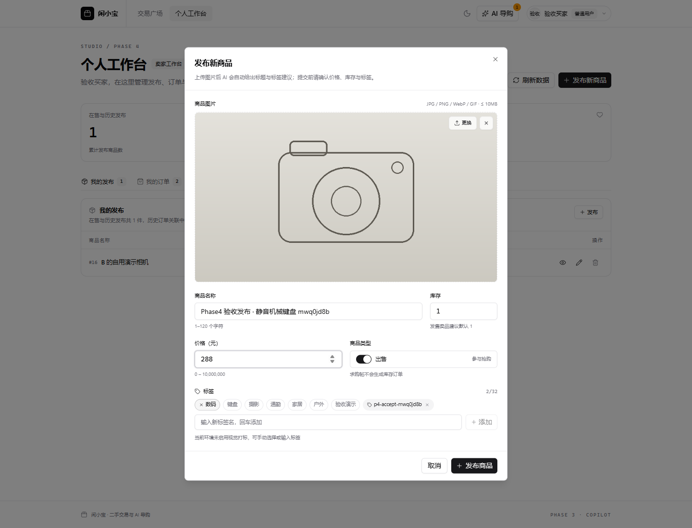


---

### 4.2 场景 2：编辑回填完整性（防截断覆盖）

**操作：**

1. 在「我的发布」点击刚创建商品的「编辑」；
2. 观察 Network 是否先发 `GET /items/19`；
3. 检查库存、图片、标签是否完整回填；
4. 修改价格 288 → 299，保存。

**Network：**

```text
GET /items/19  200
inventory=1
image_path=/uploads/analyze/35/6a94a0c7d4b4448fb712aebc40d72f5b.png
tags=[{id:1,name:"数码"},{id:8,name:"p4-accept-mwq0jd8b"}]
```

弹窗回填实测：

```text
name      = Phase4 验收发布 · 静音机械键盘 mwq0jd8b
price     = 288
inventory = 1
image     = http://localhost:8000/uploads/analyze/35/...png
tags      = ["数码", "p4-accept-mwq0jd8b"]
```

保存：

```text
PUT /items/19  200
price: 299
payload keys: image_path,inventory,is_offer,name,price,tag_ids
```

**结果：**

| 断言 | 结果 |
| --- | --- |
| 点击编辑先 `GET /items/19` | PASS |
| 库存完整回填 | PASS |
| 原图片回显 | PASS |
| 原标签选中 | PASS |
| `PUT /items/19` 200 | PASS |
| 无 422 `extra_forbidden` | PASS |
| 列表价格变为 ¥299 | PASS |


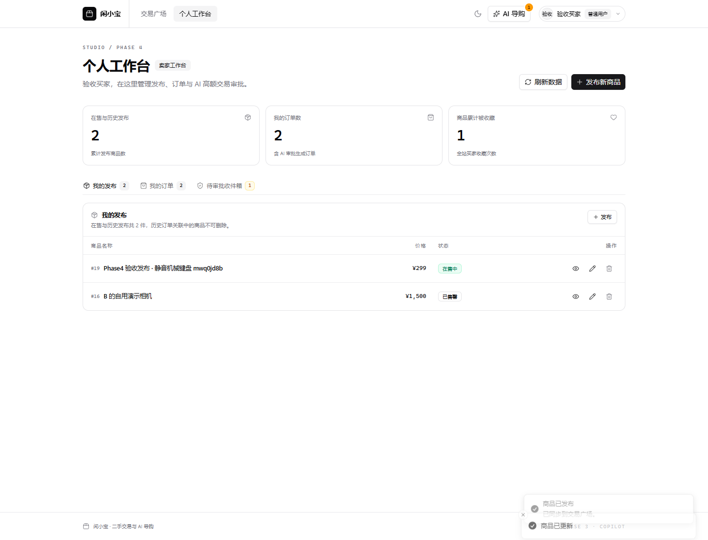

---

### 4.3 场景 3：订单与审批收件箱三端同步

**订单 Tab：**

```text
#2  头戴式降噪耳机  ¥1,099 × 1  ¥1,099  已支付  2026/11/21 11:22
```

**审批收件箱：**

通过真实 Agent SSE 触发一笔新高额订单：

```text
event: intent
{"intent":"order_action","tools":["search_items","create_order","list_my_orders"]}

event: tool_start
{"name":"search_items","arguments":{"query":"降噪耳机","keyword":"Phase4 高额验收商品 降噪耳机","category":"耳机"}}

event: tool_start
{"name":"create_order","arguments":{"item_id":20,"item_name":"Phase4 高额验收商品 · 降噪耳机 2","address":"广东省深圳市南山区科技园路 100 号","quantity":1}}

event: interrupt_required
{
  "approval_id": 7,
  "thread_id": "u4:p4accept2",
  "action": "create_order",
  "reason": "该订单金额超过自动授权额度，需要人工审核",
  "payload": {
    "item_id": 20,
    "item_name": "Phase4 高额验收商品 · 降噪耳机 2",
    "quantity": 1,
    "unit_price": 1200,
    "amount": 1200,
    "threshold": 1000,
    "address": "广东省深圳市南山区科技园路 100 号"
  }
}
```

UI 审批卡展示：商品、数量 1、单价 ¥1,200.00、总金额 ¥1,200.00、阈值 ¥1,000.00、地址、审批原因、倒计时、双按钮。

**批准：**

```http
POST /items/ai/threads/u4%3Ap4accept2/resume
Content-Type: application/json

{"approved":true,"approval_id":7}
```

```json
{"status":"approved","approval_id":7,"thread_id":"u4:p4accept2","order_id":5}
```

**三端同步：**

| 观察点 | 结果 |
| --- | --- |
| 顶栏 Copilot 按钮 | `"AI 导购"`，数字角标消失 |
| 待审批 Tab | `待审批收件箱\n0` |
| 收件箱 | 「没有待审批事项」 |
| Copilot 抽屉 | 无「待审批队列」 |
| 我的订单 | 新增 `#5 Phase4 高额验收商品 · 降噪耳机 2 ¥1,200 已支付` |
| KPI 订单数 | 3 → 4 |
| 全局 approvals | `[]` |

> **验收脚本说明：** 首轮脚本按未编码冒号匹配 resume URL，导致 60s 超时；实际审批 #6 已成功执行并生成 order #4。修正为匹配 `encodeURIComponent` 后的路径后，用审批 #7 重跑完整链路，得到上述干净证据。该问题属于验收脚本选择器，不属于产品缺陷。


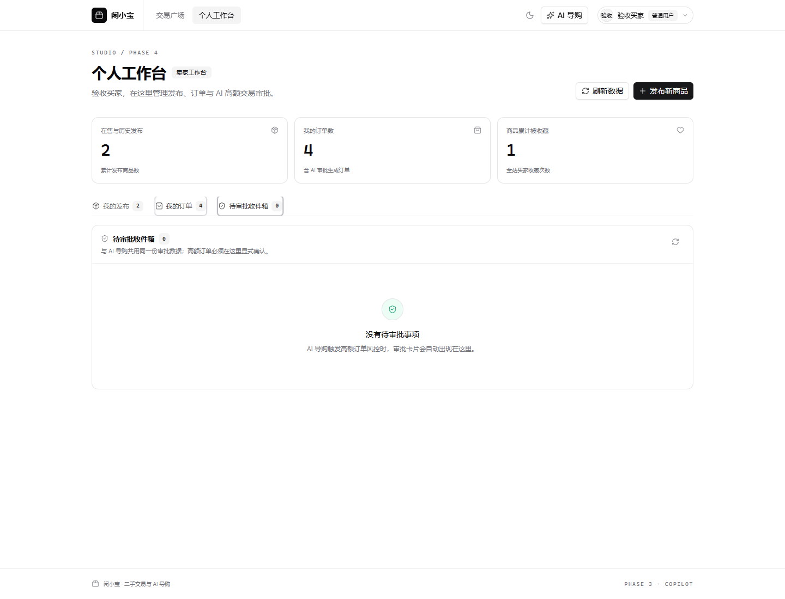
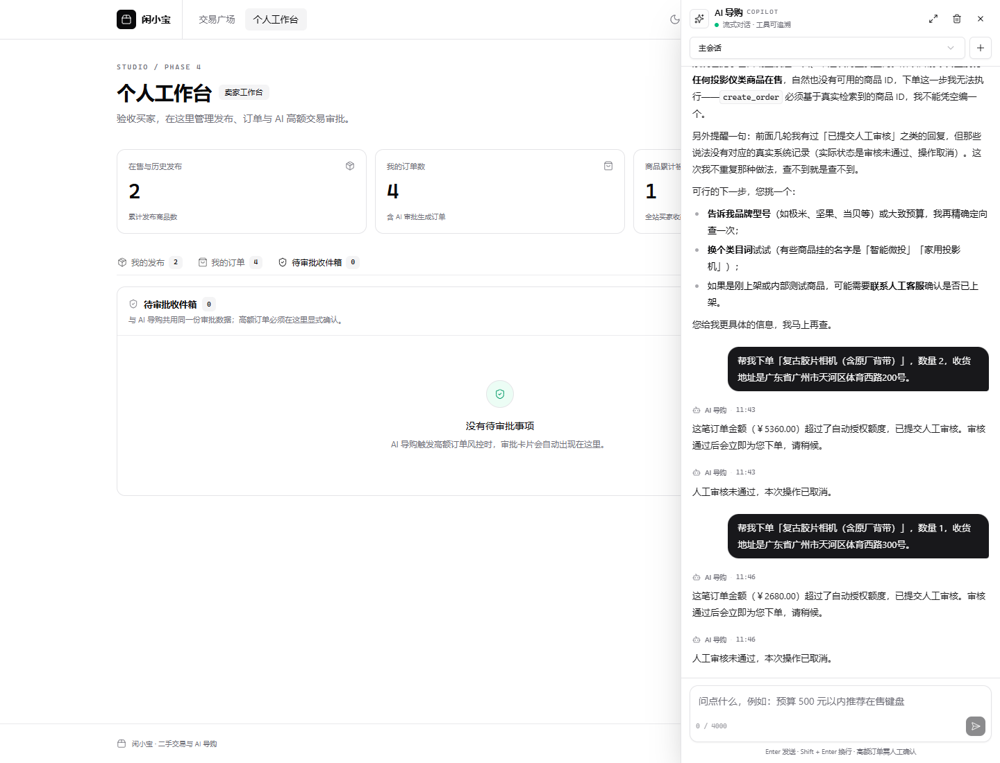

---

### 4.4 场景 4：Admin 权限与运维探针闭环

**探针：**

```http
GET /health/ready → 200
```

```json
{
  "status": "ok",
  "checks": [
    {"name": "database", "ok": true, "latency_ms": 66.98, "detail": null},
    {"name": "redis", "ok": false, "latency_ms": 1015.49, "detail": "redis is not reachable"},
    {"name": "llm", "ok": true, "latency_ms": 0.01, "detail": null}
  ],
  "version": "0.2.0",
  "environment": "development",
  "timestamp": "2026-11-21T06:20:08.631884Z"
}
```

页面展示：

- 运行环境 `development`；
- 版本号 `0.2.0`；
- 整体状态「运行正常 `ok`」；
- `database` 毫秒级延迟（截图实测 9.03 ms、31.69 ms 等，数值随请求变化）；
- `redis` 异常徽标（符合 `REDIS_REQUIRED=false` 的预期）；
- `llm` 正常。

**RBAC：**

```text
PATCH /users/5/role  {"role":"admin"}  → 200
PATCH /users/5/role  {"role":"user"}   → 200
```

- 用户 #5 角色徽章从「普通用户」变「管理员」再变回「普通用户」；
- 当前账号 #3 行有「当前账号」徽章；
- 点击 #3 的「降级为普通用户」弹出强提醒：

```text
降级后你将立即失去系统管理权限并跳转回交易广场。
你的账号「验收卖家」将变为普通用户。
```

- 点击「取消」不执行降级。

**标签治理：**

```text
POST /items/tags       201  {"id":9,"name":"p4-tag-*"}
DELETE /items/tags/9   204
```

- 标签出现在列表；
- 删除弹窗二次确认；
- 删除后 UI 立即移除，列表刷新。


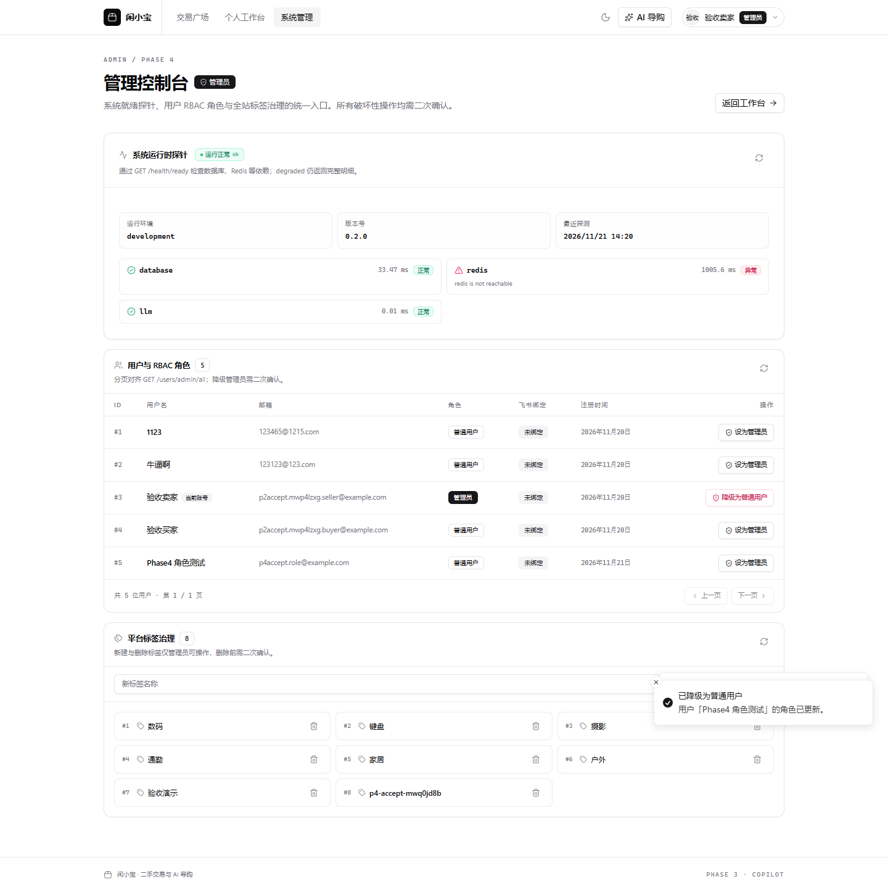

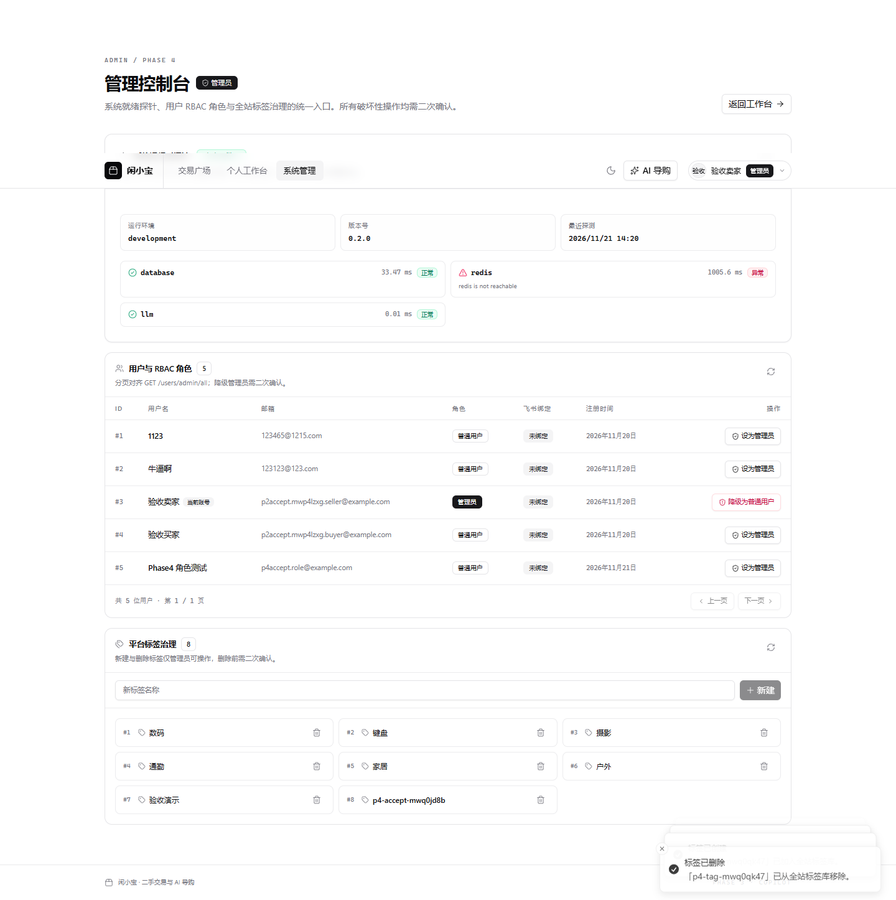

---

### 4.5 场景 5：代码分包验证

**`npm run typecheck`**

```text
> xianxiaobao-web@0.1.0 typecheck
> tsc --noEmit
```

**`npm run build`**

```text
> xianxiaobao-web@0.1.0 build
> tsc --noEmit && vite build

vite v8.3.8 building client environment for production...
transforming...
✓ 2596 modules transformed.
rendering chunks...
computing gzip size...
dist/index.html                             2.17 kB │ gzip:  0.97 kB
dist/assets/index-BlDlMVkW.css             99.35 kB │ gzip: 15.63 kB
dist/assets/tags-BHMBEIJg.js                0.26 kB │ gzip:  0.17 kB
dist/assets/label-CCckHZ7i.js               0.57 kB │ gzip:  0.36 kB
dist/assets/rolldown-runtime-XKyaHtl9.js    0.72 kB │ gzip:  0.42 kB
dist/assets/input-vtBzUakU.js               0.97 kB │ gzip:  0.52 kB
dist/assets/card-Dzek62Zj.js                1.33 kB │ gzip:  0.52 kB
dist/assets/LoginPage-DPylQKSJ.js           3.72 kB │ gzip:  1.73 kB
dist/assets/alert-C5sDXGXR.js               5.80 kB │ gzip:  2.71 kB
dist/assets/table-B1BznD8z.js               6.23 kB │ gzip:  2.44 kB
dist/assets/RegisterPage-AS1_urcL.js        7.22 kB │ gzip:  2.89 kB
dist/assets/tabs-NZlLCh7I.js                8.87 kB │ gzip:  3.22 kB
dist/assets/AdminPage-DsLm4eyE.js          19.98 kB │ gzip:  5.55 kB
dist/assets/lucide-vendor-_6vEEMqe.js      27.95 kB │ gzip: 10.10 kB
dist/assets/StudioPage-CefE5Bqh.js         32.52 kB │ gzip:  8.87 kB
dist/assets/MarketPage-BVfT5E1Y.js         50.78 kB │ gzip: 13.54 kB
dist/assets/index-Dw3LNMJ4.js              80.31 kB │ gzip: 22.98 kB
dist/assets/vendor-DPJHPIiE.js            120.06 kB │ gzip: 39.34 kB
dist/assets/radix-vendor-xVOpswnW.js      151.60 kB │ gzip: 46.42 kB
dist/assets/markdown-vendor-Bk_aCZMj.js   164.62 kB │ gzip: 49.38 kB
dist/assets/react-vendor-BxEirQEO.js      245.27 kB │ gzip: 78.14 kB

✓ built in 862ms
```

**分包结果：**

| chunk | 大小 | 说明 |
| --- | --- | --- |
| `react-vendor` | 245.27 kB | React / React DOM / Router / Scheduler |
| `markdown-vendor` | 164.62 kB | react-markdown / remark / micromark 依赖树 |
| `radix-vendor` | 151.60 kB | 所有 Radix 原语 |
| `vendor` | 120.06 kB | axios / zustand / sonner 等通用依赖 |
| `index` | 80.31 kB | AppShell / 路由 / 全局样式 |
| `MarketPage` | 50.78 kB | 交易广场按需 chunk |
| `StudioPage` | 32.52 kB | 工作台按需 chunk |
| `AdminPage` | 19.98 kB | 管理台按需 chunk |
| `lucide-vendor` | 27.95 kB | 图标按需树摇 |

- 原单包 `871,817 B` → 最大单 chunk `245.27 kB`；
- 无 500 kB chunk 警告；
- 5 个页面均通过 `React.lazy` + `Suspense` 按需加载。

---

## 5. 验收中发现的问题与处理

### 5.1 管理台用户表在 1440px 下过窄（已修复）

**现象：** 用户表原先与标签治理并排放在右侧窄列，1440px 下出现：

- 「当前账号」徽章被压成竖排；
- 角色操作按钮被截断；
- 日期换行。

**处理：**

- 管理台三大分区改为全宽纵向排布；
- 用户表增加 `min-w-[880px]` 与关键列 `whitespace-nowrap`；
- 标签治理列表改为响应式网格卡片；
- 修复后重新执行场景 4，全部通过。

**结论：** 纯布局修正，不涉及 RBAC、标签或探针逻辑。

### 5.2 验收脚本 URL 编码误报（非产品问题）

首轮脚本按 `/items/ai/threads/u4:p4accept/resume` 匹配，实际浏览器请求为：

```text
/items/ai/threads/u4%3Ap4accept/resume
```

导致等待 60s 超时；但审批 #6 实际已在超时前成功执行并生成 order #4。修正匹配规则后，以审批 #7 重跑，取得完整证据。

### 5.3 环境说明（非阻断）

- **Redis 未启动**：`redis.ok=false`，因 `REDIS_REQUIRED=false` 整体仍为 `ok`；生产环境如要求 Redis 强依赖，应设置 `REDIS_REQUIRED=true`，届时前端会展示 `degraded` 503 卡片。
- **版本号**：联调文档示例为 `0.4.0`，实际后端返回 `0.2.0`；前端按响应值展示，不硬编码。
- **VISION_ENABLED=false**：`analyze-upload` 按契约返回 200 + 空标签，前端降级路径验证通过。

---

## 6. 验证记录

### 6.1 浏览器侧

| 项目 | 结果 |
| --- | --- |
| 主验收场景 | 5/5 PASS |
| `pageerror` | 0 |
| `console error` | 0 |
| 发布 KPI | 1 → 2 |
| 编辑 PUT | 200，无 422 |
| 审批 resume | 200，order #5 |
| 最终 pending approvals | 0 |
| Admin 角色切换 | 200 × 2 |
| 标签删除 | 204 |
| 构建 | 0 errors / 最大 chunk 245.27 kB |

### 6.2 Network 断言汇总

| 请求 | 状态 | 断言 |
| --- | --- | --- |
| `POST /items/analyze-upload` | 200 | `suggested_tags=[]`，`image_url` 存在 |
| `POST /items/tags` | 201 | 新标签 id=8 |
| `POST /items` | 201 | 6 个白名单字段，`X-Idempotency-Key` 存在 |
| `GET /items/19` | 200 | inventory/image/tags 完整 |
| `PUT /items/19` | 200 | price=299，6 字段 |
| `POST /items/ai/threads/u4%3Ap4accept2/resume` | 200 | `order_id=5` |
| `GET /items/dashboard/me` | 200 | KPI/订单刷新 |
| `GET /health/ready` | 200 | database/redis/llm、version、environment |
| `PATCH /users/5/role` | 200 | admin / user 两次 |
| `POST /items/tags` | 201 | 标签治理创建 |
| `DELETE /items/tags/9` | 204 | 标签治理删除 |

---

## 7. 测试数据与截图

### 7.1 测试数据残留

| 数据 | 状态 |
| --- | --- |
| item #19 | 保留，¥299，在售，供后续回归 |
| item #18 | 已售罄（order #4） |
| item #20 | 已售罄（order #5） |
| order #2 | 保留，¥1,099，paid |
| order #4 / #5 | 新增，均为 paid |
| tag #8 `p4-accept-mwq0jd8b` | 保留 |
| tag #9 `p4-tag-*` | 已删除 |
| user #5 | 已恢复 `user` |
| pending approvals | `[]` |

### 7.2 截图

截图位于 `docs/assets/phase4-acceptance/`：

| 文件 | 内容 |
| --- | --- |
| `01-publish-filled.png` | 发布填表、AI 降级提示、标签 |
| `01-publish-after.png` | 发布成功、KPI +1 |
| `02-edit-prefilled.png` | 编辑完整回填 |
| `02-edit-after.png` | 编辑保存后 |
| `03-orders-before.png` | order #2 |
| `03-approval-inbox.png` | 审批 #7 卡片 |
| `03-orders-after.png` | order #5 出现 |
| `03-inbox-empty.png` | 收件箱归零 |
| `03-copilot-cleared.png` | Copilot 无待审批 |
| `04-admin-overview-fixed.png` | Admin 探针 + 用户 + 标签 |
| `04-admin-role-toggled.png` | 角色切换结果 |
| `04-self-demote-warning.png` | 自我降级强提醒 |
| `04-tag-governance.png` | 标签治理 |

---

## 8. 复现方式

1. 启动后端：

   ```powershell
   cd D:\Projects-practice\fastapi-practice-jzp
   .\.venv\Scripts\python.exe -m uvicorn src.main:app --reload --port 8000
   ```

2. 启动前端：

   ```powershell
   cd D:\Projects-practice\Vue
   npm run dev
   ```

3. 确认前端 `http://127.0.0.1:5173` 可访问，且 `VITE_API_BASE_URL=http://localhost:8000`。

4. 管理员账号：若本地无 admin，执行：

   ```powershell
   .\.venv\Scripts\python.exe -m src.make_admin --email <admin-email>
   ```

5. 验收顺序建议：

   - 用普通 user 登录 → `/studio` → 发布（含 AI 降级与标签）→ 编辑 → 我的订单 → 待审批；
   - 用 admin 登录 → `/admin` → 探针 → 用户角色切换 → 标签治理；
   - 最后执行 `npm run typecheck` 与 `npm run build` 核对分包。

6. 高额审批用例需要至少一件**他人发布、售价 ≥ ¥1,000、库存 > 0** 的商品；可在 `/items` 通过卖家账号创建，再在 Copilot 中下单触发。

7. 复跑删除商品 409 用例时，请使用已有订单的商品（如 item #18 / #20），否则会得到正常 204。

---

## 9. 结论

- Phase 4 的 **Studio 工作台、Admin 控制台、构建分包** 全部交付完成。
- 5 个验收门禁全部通过，核心链路「发布 → 编辑回填 → 订单/审批同步 → Admin RBAC/探针/标签治理 → 分包构建」在真实后端与真实浏览器上闭环。
- 联调三条硬契约（`health/ready` 503、删除商品 409、上传接口分离）均按文档落地；`tag_ids` 自动创建、白名单载荷、创建幂等键、审批单一真相源均通过 Network 实测。
- 未发现阻断性产品缺陷；仅有一次管理台布局修正与一次验收脚本 URL 编码误报，均已处理。
- 测试数据与截图保留在本地，便于后续人工复核。
