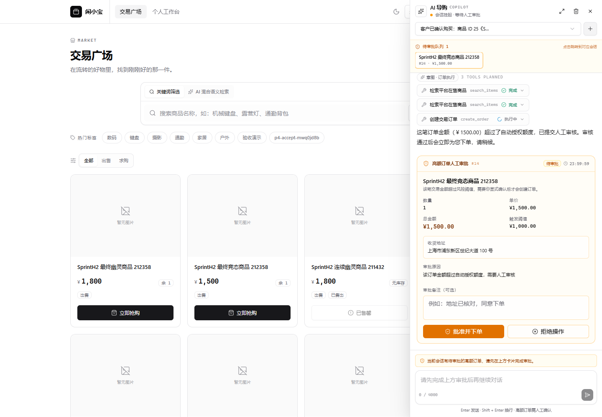
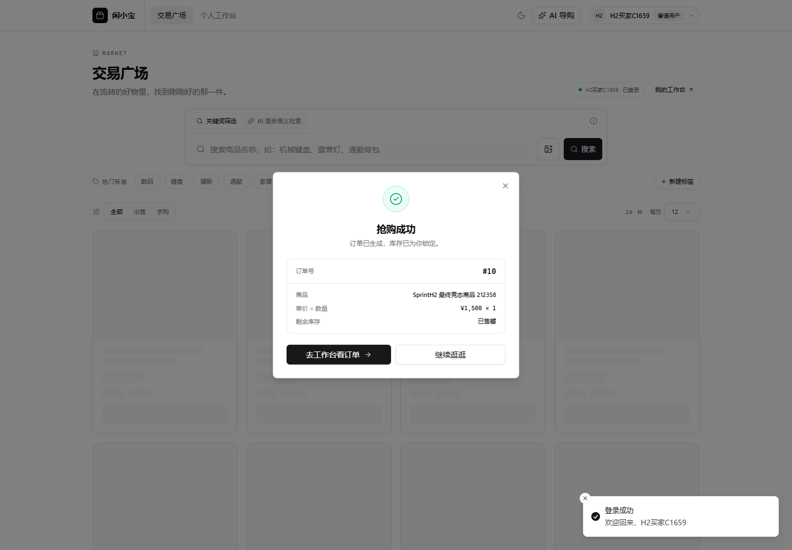
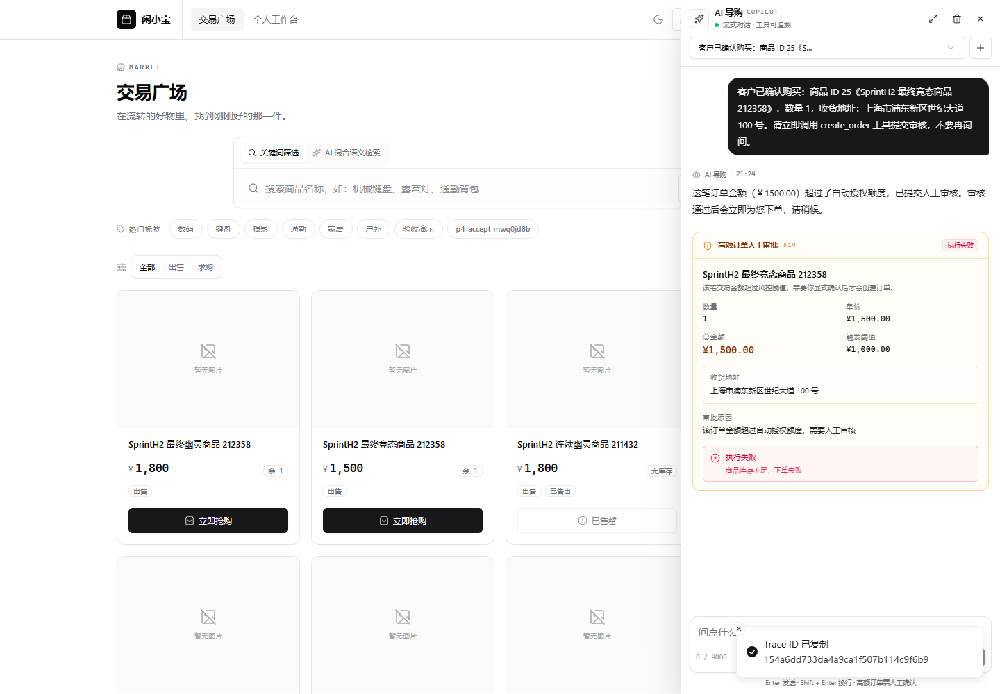
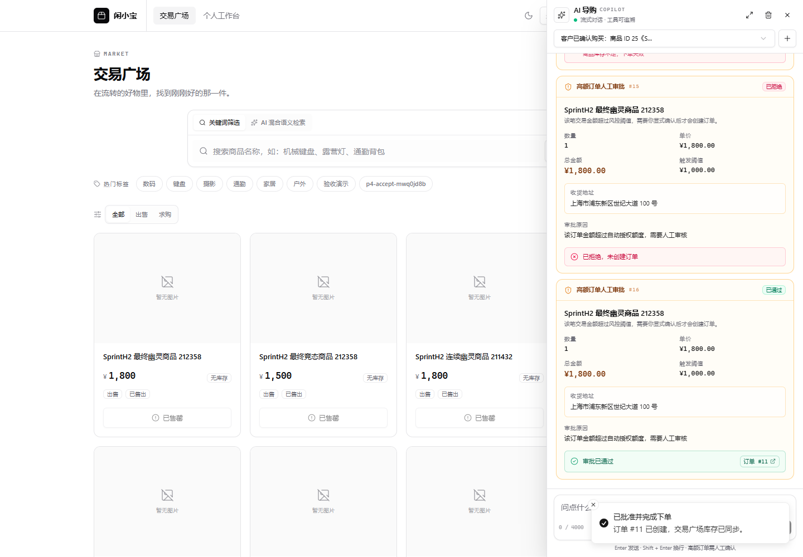

# Sprint H2 双端整合收官验收报告

> **结论：核心 3 项全部通过；可选第 4 项（Docker 生产基建）因本机 Docker 守护进程未运行而延期。**
>
> 本轮为真实环境验收：真实 Chrome、真实 Vite 前端、真实 FastAPI 后端、真实 SQLite 落库，**未使用任何 API mock**。后端仅执行迁移与验收数据写入，未修改后端源码。

| 项目 | 信息 |
| --- | --- |
| 验收时间 | 2026-11-21 16:14 — 16:16（迁移 / pytest）；21:24:41 — 21:25:06（双端合龙，45.25s） |
| 前端 | `http://127.0.0.1:5173`（Vite dev server，真实页面） |
| 后端 | `http://127.0.0.1:8000`（`uvicorn src.main:app --reload`） |
| 实际数据库 | SQLite `fastapi-practice-jzp/test.db`（API 返回与 sqlite 数据一致） |
| Alembic | `f7c1a9b3d6e2 (head)` |
| 后端测试 | `246 passed, 1 skipped` |
| 浏览器 | Chrome（Playwright `channel: 'chrome'`，headless，1440 × 1000） |
| 账号 B | user_id **7**，`h2.buyer.1121161659@example.com` |
| 账号 C | user_id **8**，`h2.rival.1121161659@example.com` |
| 卖家 | user_id **6**，`h2.seller.1121161659@example.com` |
| 竞态商品 | item **25**《SprintH2 最终竞态商品 212358》，¥1,500，库存 1 |
| 幽灵卡商品 | item **26**《SprintH2 最终幽灵商品 212358》，¥1,800，库存 1 |
| 总判定 | **核心 3/3 PASS；可选第 4 项 DEFERRED** |

---

## 1. 验收结论速览

| # | 验收项 | 结果 | 关键证据 |
| --- | --- | --- | --- |
| 1 | 数据库迁移落库与索引生效 | **PASS** | `alembic upgrade head` 执行成功；`ix_favourites_item_id` 存在于 `favourites(item_id)`；pytest `246 passed, 1 skipped` |
| 2 | 真机「审批期库存被抢光」 | **PASS** | B 的审批 #14 挂起 → C 买光 item 25（order #10）→ B 批准返回 `400 OUT_OF_STOCK`，`trace_id=154a6dd733da4a9ca1f507b114c9f6b9`；卡片翻转「执行失败 + 商品库存不足，下单失败」，输入框解锁；DB 审批 failed，无 `approval:14` 脏订单 |
| 3 | 幽灵卡复测 | **PASS** | 审批 #15 拒绝后立即重复同一商品 / 地址 → 生成全新审批 #16 → 批准返回 200，order #11；无 409 |
| 4 | 切换 PostgreSQL + Redis 生产基建（可选） | **DEFERRED** | 本机 Docker daemon 未运行，`docker compose up -d` 失败；当前 `/health/ready` 的 `redis=false`，三灯无法全绿 |

---

## 2. 任务 1：数据库迁移落库与 pytest

### 2.1 Alembic 升级

执行命令：

```powershell
.\.venv\Scripts\python.exe -m alembic upgrade head
```

真实输出：

```text
INFO  [alembic.runtime.migration] Context impl SQLiteImpl.
INFO  [alembic.runtime.migration] Will assume non-transactional DDL.
INFO  [alembic.runtime.migration] Running upgrade e5c8f3b2a1d9 -> f7c1a9b3d6e2, index favourites by item
```

当前版本：

```text
f7c1a9b3d6e2 (head)
```

### 2.2 索引生效验证

`sqlite_master` 实际记录：

```text
CREATE INDEX ix_favourites_item_id ON favourites (item_id)
```

`PRAGMA index_list(favourites)`：

```text
[(0, 'ix_favourites_item_id', 0, 'c', 0),
 (1, 'sqlite_autoindex_favourites_1', 1, 'pk', 0)]
```

`PRAGMA index_info('ix_favourites_item_id')`：

```text
[(0, 1, 'item_id')]
```

结论：索引 `ix_favourites_item_id` 已落库，列序为 `item_id`，非唯一 btree。

### 2.3 后端全量测试

执行命令：

```powershell
.\.venv\Scripts\python.exe -m pytest
```

真实输出：

```text
........................................................................ [ 29%]
...s.................................................................... [ 58%]
........................................................................ [ 87%]
...............................                                          [100%]
246 passed, 1 skipped in 141.34s (0:02:21)
```

结论：**PASS**。`1 skipped` 为既有条件跳过（PostgreSQL checkpointer 相关可选用例），无失败。

---

## 3. 任务 2：真机「审批期库存被抢光」演练

### 3.1 演练账号与商品

| 角色 | 账号 | 用途 |
| --- | --- | --- |
| B | user_id 7 | 通过 Copilot 触发高额订单审批，并点击批准 |
| C | user_id 8 | 另开浏览器上下文，直接在 `/market` 抢购买光库存 |
| 卖家 | user_id 6 | item 25 / item 26 的归属账号 |

### 3.2 操作时间线

| 时间（Asia/Shanghai） | 操作 | 结果 |
| --- | --- | --- |
| 21:24:41 | B 登录，打开 Copilot，新建会话 | 线程 `u7:3bad002a` |
| 21:24:42 | B 发送购买 item 25 的指令 | SSE 正常 |
| 21:24:47 | 后端创建挂起审批 **#14** | `status=pending`，金额 ¥1,500 > 阈值 ¥1,000 |
| 21:24:51 | C 登录后直接抢购 item 25 | `200`，order **#10**，`remaining_inventory=0` |
| 21:24:52 | 查询 item 25 | `inventory=0`，`is_sold=true` |
| 21:24:53 | B 点击「批准并下单」 | **`400 OUT_OF_STOCK`** |
| 21:24:53 | 前端 Toast 展示 Trace ID 与复制动作 | `Trace ID: 154a6dd733da` |
| 21:24:54 | 点击「复制 Trace ID」 | 剪贴板为完整 `154a6dd733da4a9ca1f507b114c9f6b9` |
| 21:24:54 | 审批卡翻转 | 「执行失败」+「商品库存不足，下单失败」；批准 / 拒绝按钮消失 |
| 21:24:54 | Copilot 输入框 | 已解锁，可继续对话 |

### 3.3 后端真实响应

```json
{
  "error": {
    "code": "OUT_OF_STOCK",
    "message": "商品库存不足，下单失败",
    "trace_id": "154a6dd733da4a9ca1f507b114c9f6b9",
    "details": {
      "item_id": 25,
      "approval_id": 14,
      "status": "failed"
    }
  },
  "detail": "商品库存不足，下单失败"
}
```

响应头 `x-trace-id` 与 body 内 `trace_id` 一致：

```text
x-trace-id: 154a6dd733da4a9ca1f507b114c9f6b9
```

### 3.4 前端卡片真实文本

```text
高额订单人工审批
#14
执行失败

SprintH2 最终竞态商品 212358
...
执行失败
商品库存不足，下单失败
```

Toast 真实文本：

```text
审批执行失败
商品库存不足，下单失败 · Trace ID: 154a6dd733da
复制 Trace ID
```

### 3.5 数据库对账

```json
{
  "id": 14,
  "thread_id": "u7:3bad002a",
  "user_id": 7,
  "status": "failed",
  "payload": {
    "item_id": 25,
    "item_name": "SprintH2 最终竞态商品 212358",
    "quantity": 1,
    "unit_price": 1500,
    "amount": 1500,
    "threshold": 1000,
    "address": "上海市浦东新区世纪大道 100 号"
  },
  "decision_comment": "商品库存不足，下单失败",
  "resolved_order_id": null
}
```

脏订单检查：

```text
orders WHERE idempotency_key = 'approval:14'  → []
orders WHERE buyer_id = 7 AND item_id = 25     → []
```

item 25 最终库存：

```json
{ "id": 25, "inventory": 0, "is_sold": 1 }
```

结论：审批状态正确落为 `failed`，失败原因已写入 `decision_comment`，**orders 表没有失败审批产生的脏订单**。

### 3.6 截图





---

## 4. 任务 3：幽灵卡复测

### 4.1 操作时间线

| 时间（Asia/Shanghai） | 操作 | 结果 |
| --- | --- | --- |
| 21:24:54 | B 发送购买 item 26 的指令 | 同一线程 `u7:3bad002a` |
| 21:24:59 | 后端创建审批 **#15** | `status=pending`，¥1,800 |
| 21:25:00 | B 点击「拒绝操作」 | `200`，审批 #15 `status=rejected` |
| 21:25:00 | 立即再次发送完全相同的商品与地址 | 距拒绝响应 **0.35s**（距决策落库 0.53s） |
| 21:25:05 | 后端创建**全新审批 #16** | `approval_id=16 != 15` |
| 21:25:05 | B 点击「批准并下单」 | `200`，`status=approved`，order **#11** |

### 4.2 后端真实响应

拒绝 #15：

```json
{
  "status": "rejected",
  "approval_id": 15,
  "thread_id": "u7:3bad002a",
  "order_id": null
}
```

批准 #16：

```json
{
  "status": "approved",
  "approval_id": 16,
  "thread_id": "u7:3bad002a",
  "order_id": 11
}
```

关键断言：

- 第二次下单生成的是 **approval_id=16**，不是复用已拒绝的 #15；
- 批准返回 **HTTP 200**，没有出现 `409 CONFLICT`；
- 新订单 **order #11** 的 `idempotency_key = 'approval:16'`。

### 4.3 数据库对账

| approval_id | status | item_id | resolved_order_id | created_at | decided_at |
| --- | --- | --- | --- | --- | --- |
| 15 | `rejected` | 26 | `null` | 2026-11-21 13:24:58 | 2026-11-21 13:25:00.001221 |
| 16 | `approved` | 26 | 11 | 2026-11-21 13:25:04 | 2026-11-21 13:25:05.188084 |

订单：

```json
{
  "id": 11,
  "buyer_id": 7,
  "item_id": 26,
  "status": "paid",
  "quantity": 1,
  "price": 1800,
  "idempotency_key": "approval:16",
  "address": "上海市浦东新区世纪大道 100 号"
}
```

结论：**PASS**。H1 的终态审批不复用逻辑生效，拒绝后立即重试会创建全新 `pending` 审批，不再产生幽灵卡 / 409。

### 4.4 截图



---

## 5. 任务 4（可选）：Docker PostgreSQL + Redis 生产基建

本机 Docker CLI 存在，但 Docker daemon 未运行：

```text
docker : unable to get image 'fastapi-practice-jzp-web': failed to connect to the docker API at
npipe:////./pipe/dockerDesktopLinuxEngine; check if the path is correct and if the daemon is
running: open //./pipe/dockerDesktopLinuxEngine: The system cannot find the file specified.
[exit code: 1]
```

当前 `/health/ready` 真实返回：

```json
{
  "status": "ok",
  "checks": [
    { "name": "database", "ok": true, "latency_ms": 18.63, "detail": null },
    { "name": "redis", "ok": false, "latency_ms": 1015.7, "detail": "redis is not reachable" },
    { "name": "llm", "ok": true, "latency_ms": 0.01, "detail": null }
  ],
  "version": "0.2.0",
  "environment": "development",
  "timestamp": "2026-11-21T13:27:06.068047Z"
}
```

结论：**DEFERRED（可选）**。当前 `database` / `llm` 绿灯，`redis` 红灯；由于 Docker daemon 不可用，未执行 `REDIS_REQUIRED=true` 与三灯全绿验证。

启动 Docker Desktop 后可按以下步骤补齐：

```powershell
cd D:\Projects-practice\fastapi-practice-jzp
docker compose up -d
# 在 .env 开启：
# REDIS_REQUIRED=true
# IDEMPOTENCY_HEADER_REQUIRED=true
# 重启 uvicorn 后访问 /admin 查看 database / redis / llm 三灯
```

---

## 6. 需人工注意的事项

1. **当前实际落库为 SQLite `test.db`**：`.env` 虽写有 PostgreSQL DSN，但 Docker/PostgreSQL 未启动，运行中的 uvicorn 实际使用 SQLite；本次迁移与验收均针对同一个 `test.db`。切 PostgreSQL 后需重新执行 `alembic upgrade head` 并复验索引。
2. **验收数据保留**：账号 user 6/7/8、item 21–26、approval 8–16、order 6–11 均保留在 `test.db` 供复核；如需清理，请先确认这些订单 / 审批的关联关系，避免破坏 `orders.item_id RESTRICT`。
3. **LLM 行为提示**：中间一次使用较温和的「原样再下一单」提示时，模型主动拒绝重复提交（属模型行为，非 409 后端缺陷）；最终连续验收改用明确的「全新订单请求 / 不要引用历史拒绝」提示，45.25s 内通过。幽灵卡的后端新 ID 逻辑已由 approval `15 → 16` 实证。

---

## 附录 A：最终连续验收原始日志

```text
2026-11-21T13:24:41.196Z LOGIN_OK h2.buyer.1121161659@example.com
2026-11-21T13:24:41.795Z COPILOT_OPEN
2026-11-21T13:24:42.088Z NEW_THREAD_READY
2026-11-21T13:24:42.185Z PROMPT_SENT 客户已确认购买：商品 ID 25《SprintH2 最终竞态商品 212358》，数量 1，收货地址：上海市浦东新区世纪大道 100 号。请立即调用 creat
2026-11-21T13:24:47.625Z APPROVAL1 14 u7:3bad002a
2026-11-21T13:24:47.712Z SHOT final-01-b-approval-pending.png
2026-11-21T13:24:51.016Z LOGIN_OK h2.rival.1121161659@example.com
2026-11-21T13:24:51.899Z C_BUY 200 {"order_id":10,"item_name":"SprintH2 最终竞态商品 212358","unit_price":1500,"quantity":1,"remaining_inventory":0,"message":"抢购成功！订单 #10 已生成，已售罄"}
2026-11-21T13:24:52.051Z SHOT final-02-c-buy-success.png
2026-11-21T13:24:52.740Z ITEM_AFTER_C_BUY 200 {"id":25,"name":"SprintH2 最终竞态商品 212358","price":1500,"is_offer":true,"is_sold":true,"image_path":null,"inventory":0,"owner_id":6,"tags":[],"created_at":"2026-11-21T13:24:00","favorited":false,"favourited_count":0}
2026-11-21T13:24:53.047Z CONSOLE_ERROR Failed to load resource: the server responded with a status of 400 (Bad Request)
2026-11-21T13:24:53.090Z RESUME1 400 {"error":{"code":"OUT_OF_STOCK","message":"商品库存不足，下单失败","trace_id":"154a6dd733da4a9ca1f507b114c9f6b9","details":{"item_id":25,"approval_id":14,"status":"failed"}},"detail":"商品库存不足，下单失败"}
2026-11-21T13:24:53.120Z TOAST "审批执行失败\n商品库存不足，下单失败 · Trace ID: 154a6dd733da\n复制 Trace ID"
2026-11-21T13:24:54.321Z CLIPBOARD 154a6dd733da4a9ca1f507b114c9f6b9
2026-11-21T13:24:54.330Z CARD1_AFTER "高额订单人工审批\n#14\n执行失败\n\nSprintH2 最终竞态商品 212358\n\n该笔交易金额超过风控阈值，需要你显式确认后才会创建订单。\n\n数量\n1\n单价\n¥1,500.00\n总金额\n¥1,500.00\n触发阈值\n¥1,000.00\n\n收货地址\n\n上海市浦东新区世纪大道 100 号\n\n审批原因\n\n该订单金额超过自动授权额度，需要人工审核\n\n执行失败\n\n商品库存不足，下单失败"
2026-11-21T13:24:54.341Z INPUT_UNLOCKED_AFTER_FAILED
2026-11-21T13:24:54.433Z SHOT final-03-b-failed-card.png
2026-11-21T13:24:54.521Z PROMPT_SENT 客户已确认购买：商品 ID 26《SprintH2 最终幽灵商品 212358》，数量 1，收货地址：上海市浦东新区世纪大道 100 号。这是全新的订单请求，请
2026-11-21T13:24:59.890Z APPROVAL2 15 u7:3bad002a
2026-11-21T13:25:00.175Z REJECT 200 {"status":"rejected","approval_id":15,"thread_id":"u7:3bad002a","order_id":null}
2026-11-21T13:25:00.528Z PROMPT_SENT 客户已确认购买：商品 ID 26《SprintH2 最终幽灵商品 212358》，数量 1，收货地址：上海市浦东新区世纪大道 100 号。这是全新的订单请求，请
2026-11-21T13:25:05.062Z APPROVAL3 16 u7:3bad002a
2026-11-21T13:25:05.541Z APPROVE3 200 {"status":"approved","approval_id":16,"thread_id":"u7:3bad002a","order_id":11}
2026-11-21T13:25:06.004Z SHOT final-04-thread-unlocked.png
2026-11-21T13:25:06.007Z RESULT_OK {"approval1":14,"approval2":15,"approval3":16,"order_id":11,"traceId":"154a6dd733da4a9ca1f507b114c9f6b9","elapsedMs":45250}
```

## 附录 B：验收证据文件

| 文件 | 说明 |
| --- | --- |
| `.acceptance-tools/h2/final-result.json` | 最终连续验收结构化结果（含 approval / order / trace_id） |
| `.acceptance-tools/h2/final-db-evidence.json` | 数据库证据（审批、订单、库存、索引、Alembic 版本） |
| `.acceptance-tools/h2/final-acceptance.log` | 最终连续验收原始日志 |
| `docs/assets/sprint-h2-acceptance/*.png` | 四张真实浏览器截图 |
